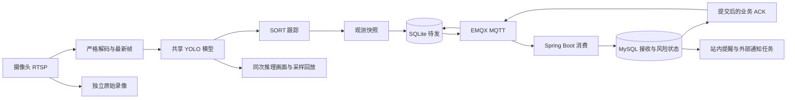
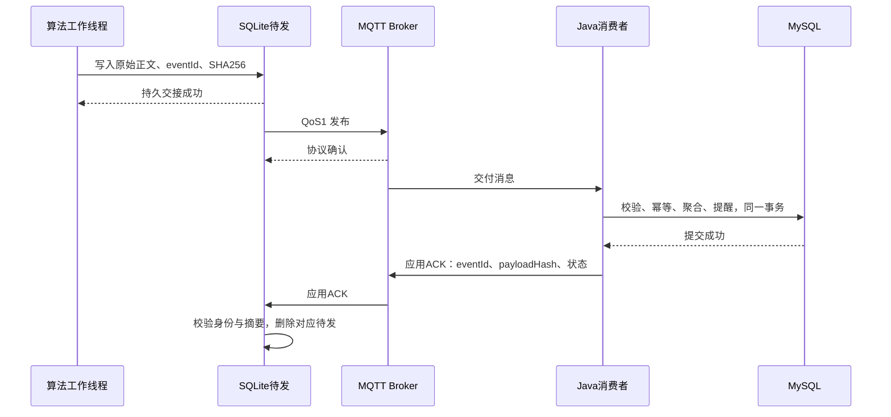
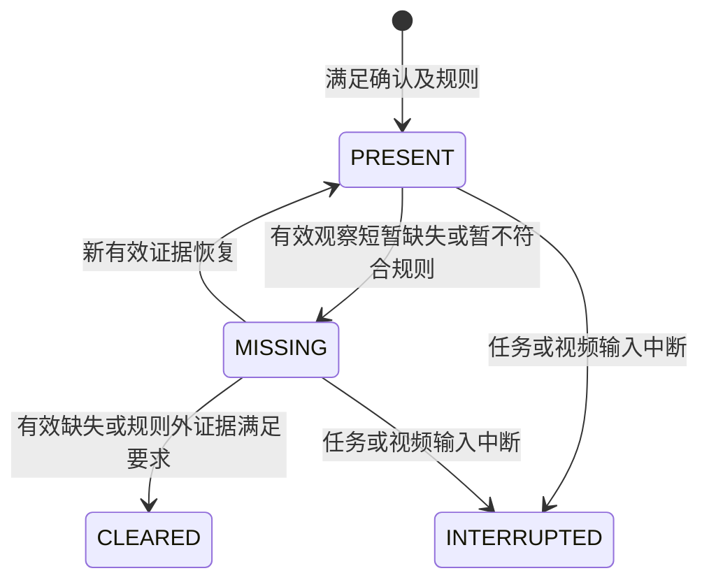

# 铁路沿线监测项目：AI 应用开发工程师面试讲解手册

以 2026-11-11 当前工作区实现和已有验收记录为依据。你的职责重点是**算法模块与告警消息传递**；后端掌握到能解释事务、状态、数据模型和接口边界即可，前端了解输入输出即可。本轮整理不修改业务代码、不重启服务。

这份材料的目标是让你能解释“为什么这样设计、代码如何实现、失败时如何处理、证据能支持什么”，而不是背技术名词。阅读顺序建议：第 1—2 节建立全局，第 3—8 节掌握职责范围，第 9—11 节补齐后端和验收，第 12—15 节练口述与追问。另附[面试前速查卡](interview-quick-reference-ai-application.md)。

## 1. 先确定你在面试中讲什么

### 1.1 一句话介绍

> 这是一个面向铁路沿线固定摄像头的视觉监测项目。我主要负责视频接入后的目标检测、跟踪和观测事件生成，以及算法端到业务后端的可靠消息链路。项目把模型识别、风险判定、通知和人工处置分开处理，重点解决持续监测、异常恢复、重复消息与告警一致性问题。

“固定摄像头”是代码支持的主要场景；仓库中个别 UAV 命名不能证明已实现无人机巡检。位置展示也不等于跨摄像头实体追踪。

### 1.2 AI 应用开发岗位应突出什么

| 能力 | 你在这个项目中应讲的内容 |
| --- | --- |
| 把模型接入应用 | 输入校验、预处理、推理、后处理、具名结果、业务接口 |
| 把识别结果变成业务动作 | 检测、跟踪、风险规则、提醒、处置各自的职责 |
| 可靠性 | 本地持久待发、业务 ACK、幂等、序号、会话隔离、异常恢复 |
| 并发与资源治理 | 一路一任务、模型共享、公平调度、最新帧、有界队列、媒体与关键事件分流 |
| 评估与排障 | 图像质量、延迟分解、实际吞吐、故障注入、端到端验证 |
| 系统协作 | 与后端约定事件协议和事务语义；了解鉴权、数据表和状态机 |

你可以把职责说成“负责算法与消息链路，参与业务协议、告警聚合和联调设计”；具体采用哪种表述，应与你实际参与的工作一致。对于本轮协助完善的部分，要读懂、能复现、能解释后再作为自己的技术经验讲。

### 1.3 项目背景与验证事实

推荐表述：

> 项目有真实需求背景，因为项目推进原因没有完成客户现场交付。目前已完善关键工程链路，做过本机部署、隔离环境完整联调、真实权重与视频验证，以及数据库和消息故障恢复测试。现场长期稳定性和误检漏检指标还需要按现场数据验收。

“具备交付所需的工程能力”“完成本机/隔离验收”“客户现场正式验收”分别需要不同证据。没有现场运行记录时，不写“客户生产环境稳定运行半年”。训练集数量、mAP、客户数、吞吐提升比例也不能补造。

## 2. 全局只需要先记住三条链路



### 2.1 视频与推理链路

RTSP → 解码检查 → 最新可用帧 → YOLO → NMS → SORT → 具名检测/跟踪结果。

RTSP 在这里用于视频传输。MQTT 传递控制、状态和观测元数据；截图、实时结果图等走受控 HTTP，原始录像使用共享目录登记。本项目没有把完整视频塞进 MQTT。

### 2.2 控制链路

管理员启用检测 → 后端把 enabled 意图写入 MySQL → 后端周期发布控制指令 → 检测进程启动或续租任务 → 返回状态和进度。

页面关闭不等于停用后台检测。浏览器也不再承担算法告警落库的必要职责。

### 2.3 告警业务链路

算法确认轨迹 → 生成观测快照 → SQLite 成功持久化 → MQTT 重试发送 → Java 验证与幂等 → 同一事务更新接收记录、风险状态、提醒/外发任务 → 提交后 ACK → 算法删除对应待发。

这条链路是你最值得讲透的部分。

### 2.4 模块职责，只记到这个程度

| 模块 | 必须知道的作用 |
| --- | --- |
| RailwayDetector | 真正执行模型、跟踪、事件生成、待发、结果图与采样录像 |
| web-springboot | 持久检测意图、直接消费算法消息、验证幂等、风险聚合、人工处置、认证和查询 |
| web-flask | 认证后的原始预览网关，复用受控读流能力，不承担主要 YOLO 检测 |
| web-vue | 展示、查询、启停和处置；检测模式显示同一次推理的图像与结果 |
| EMQX | 服务间 MQTT 发布/订阅中介 |
| MediaMTX | 本机视频转发，当前写队列 8192 |
| MySQL / SQLite | MySQL 保存服务端业务状态；SQLite 保存算法节点可靠待发和控制栅栏 |

当前部署是宿主机 Java/Python/Vite 加 Docker 中的 EMQX/MediaMTX。不能笼统地说所有业务服务都在 Docker。

## 3. 算法模块：从一帧到一组结果

### 3.1 当前实际使用的模型是什么

默认权重是 `best1030.pt`，配置路径可覆盖。既有权重检查记录显示：

- 13 类；融合后约 775 万参数。
- 检测层 stride 为 4、8、16、32，共四个尺度。
- 包含 C3、SPP、C3TR/TransformerBlock 等模块。
- 该权重检查没有发现名为 MobileViT 的实际模块。

这些结论来自[权重检查结果](test-results/delivery-audit/model-inspection.json)。仓库有 MobileViT 等源码，不足以证明当前权重使用了它们；有训练脚本，也不等于有完整训练实验记录。

类别为：防撞设备、气球、牛、水害、滑坡、违规建筑、风筝、落石、鸟巢、广告牌、坑洞、垃圾、工人。**鸟巢是一个类别，飞过的鸟并不是当前 13 类中的独立类别。**

面试中可说“基于 YOLOv5 体系的定制检测模型，当前权重具有四尺度输出和 C3TR 模块”。若追问训练过程，应以你能提供的数据和实验为准，不能凭模块存在就声称该改动提升了多少精度。

### 3.2 为什么用目标检测

系统需要输出“什么目标、出现在哪个位置”，分类模型只给整图类别不够；检测框还能提供跟踪关联和区域判断的几何依据。

但检测到“工人”不自动意味着存在违规风险；是否需要告警还取决于区域、类别规则、当前分数、停留时间等。对于滑坡、水害等复杂场景，单个类别框也不能替代完整的安全判断。

### 3.3 推理流程要能手写出来

实际入口：[model_init.py](../RailwayDetector/model_init.py) 的 `Detector.detect()`。

1. 验证输入是非空三通道 BGR 图像，检查取消信号。
2. 首次使用时懒加载权重，并用加载锁避免重复加载。
3. `letterbox` 等比例缩放和填充；默认最大输入边长 640，按模型步长对齐。
4. BGR → RGB，HWC → CHW，转为连续内存张量，加 batch 维，像素除以 255。
5. 将张量放到配置设备；当前验收使用 CPU。代码有 GPU 半精度分支，但没有本轮 GPU 性能证明。
6. 在共享模型公平门闩内执行前向，使用 `torch.no_grad()`。
7. 执行置信度过滤和 NMS。
8. 把框从缩放/填充后的坐标还原到原帧。
9. 输出 `Detection` 对象：bbox、class_id、class_name、confidence、detection_index。
10. 将检测结果送给跟踪器，每个处理帧只调用一次模型检测。

默认输入参数是 `imgsz=640`、检测置信度阈值 0.25、NMS IoU 阈值 0.3。640 不表示所有输入都会变成严格 640×640；当前 letterbox 的自动填充可以得到按步长对齐的矩形。

### 3.4 几个必须能解释的概念

**Letterbox。** 先等比例缩放，再填充，避免直接压成正方形导致目标变形。还原坐标时，需要去掉填充并除以缩放比例。若这步错了，模型类别可能没错，但框和风险区域关系会错。

**置信度。** 此版本 NMS 将 objectness 与类别分数组合，再按阈值筛选。它不是经过校准的“判断有 73% 概率正确”。花屏或域外目标也可能得到较高分。

**NMS。** 同一帧内对重叠候选框去重，通常优先保留高分框。当前默认按类别处理。它解决同帧重复框，不负责跨帧身份，也不负责业务告警去重。

**eval 与 no_grad。** 加载时的 eval 切换推理行为；no_grad 关闭本次计算的梯度记录，减少训练图相关开销。两者作用不同。

**多尺度。** 不同分辨率特征适配不同大小目标；stride 4 的细尺度可能有利于小目标表示，同时增加计算和内存成本。是否真的改善了现场小目标召回，需要有标注数据和消融实验。

**C3TR。** 将 Transformer 结构用于特征处理，涉及注意力机制与特征间关系建模。AI 应用岗位先掌握它在模型中的作用、计算成本和验证方法；没有实验数据时，不归因某项指标提升。

### 3.5 三个 0.3 不要混为一个参数

| 参数 | 解决的问题 |
| --- | --- |
| NMS IoU 0.3 | 同帧哪些候选框算重复框 |
| SORT 匹配 IoU 0.3 | 本帧框与哪个已有轨迹关联 |
| 后端重关联 IoU 0.3 | 新来源轨迹是否可接到短暂丢失的同一业务事件 |

数值相同不代表语义相同。检测阈值 0.25 和风险规则分数阈值也独立：前者减少候选，后者决定业务规则是否满足。

### 3.6 关于训练，你至少要补齐什么

必须自己核实：数据来源与授权、类别定义、样本数量及分布、标注质量、训练/验证/测试划分、相邻视频帧是否泄漏到不同集合、训练参数、权重选择标准、逐类指标和困难样本。

如果资料不全，可以说：

> 当前我能完整说明运行权重、推理和工程链路；训练集规模和训练指标要以原始实验记录为准。这次工程回归没有提供可替代现场精度评估的 mAP 结论。

AI 应用岗位不要求把开源模型算法说成原创；更看重你能否识别适用范围，并让模型稳定、可评估地服务业务。

## 4. SORT：必须懂原理，也必须懂限制

### 4.1 为什么检测后还需要跟踪

检测只告诉你每一帧的框，跟踪用于把多帧观测联系起来，支持持续出现、短暂丢失、目标级状态和重复告警控制。它提供的是估计的轨迹身份，不是经过验证的物理身份。

当前调用的是根目录的 [tracker.py](../RailwayDetector/tracker.py) 与 [kalman.py](../RailwayDetector/kalman.py)，不是看到 `Sort/` 同名目录就默认那是运行入口。

### 4.2 每一帧怎么处理

1. 预测已有轨迹在当前观测时间的框。
2. 计算当前检测框与预测框的 IoU 矩阵。
3. 简单的一对一可匹配情况直接分配；复杂情况调用匈牙利算法求分配。
4. 过滤 IoU 不达阈值的匹配。
5. 匹配成功的轨迹做 Kalman 更新，并绑定本次检测的类别、分数和 detection_index。
6. 未匹配检测创建新轨迹。
7. 未匹配旧轨迹继续老化；过期或几何状态无效则删除。
8. 只输出本次匹配成功、已确认的轨迹；不把纯预测框伪装成本帧真实检出。

IoU = 交集面积 / 并集面积。匈牙利算法在此最小化负 IoU 对应的分配代价；通常介绍复杂度为立方量级，实际还取决于矩阵规模与实现。不要把它说成“最大分数贪心挑一个框”。

### 4.3 Kalman 状态要理解到什么程度

本项目状态可理解为：

`x = [中心 x, 中心 y, 面积 s, 宽高比 r, x 速度, y 速度, 面积变化速度]`

观测为前四维。先依据运动模型预测，再用新检测纠正。F 是状态转移，H 将状态映射为观测，P 表示估计不确定性，Q/R 分别描述过程与观测噪声。

常见公式：

- 预测：x' = F x；P' = F P Fᵀ + Q。
- 更新：K = P' Hᵀ (H P' Hᵀ + R)⁻¹；x = x' + K(z − Hx')。

当前使用实际观测时间差调整 F 中的 dt。Q/R 主要是手工配置，不能说已完成现场噪声标定。匀速假设也不总符合真实运动、透视变化或快速遮挡。

### 4.4 确认和丢失参数

运行入口 `ui.make_result()` 配置 `min_hits=5`、匹配 IoU 0.3，并传入默认 3 秒的时间窗口。

- 新轨迹需要足够连续匹配才确认；不是见一帧就形成正式跟踪观测。
- 确认后在短暂丢失窗口内重新匹配，可以继续已有确认身份。
- 直播路径启用了秒级过期判断，不能只拿构造参数 `max_age=1` 就解释成“直播丢一帧立刻删”。
- min_hits 按处理帧计数。处理 FPS 较低时，确认耗时会增加。
- 事件的 firstSeen 从首次输出确认轨迹时开始记录，不等于物理目标刚进入画面的精确时间。

### 4.5 空目标和坏图必须分开

**有效图像但没有检测目标：** 仍调用跟踪更新，让轨迹老化、产生 MISSING，并在有效缺失证据充分时结束。

**图像解码损坏或源不可用：** 不制造一帧空检测；中断观测，避免将设备故障解释为目标已经离开。

### 4.6 面试官问“鸟快速经过并遮挡已有目标”

先分四层回答：

1. 鸟可能落在两次推理采样之间，系统根本没有观测到；完整原始录像有助复核，但不补回在线识别。
2. 检测层可能漏掉原目标、把两个目标合成一个框，或将域外的鸟误分为已知类别。当前有鸟巢类别，没有独立飞鸟类别。
3. SORT 使用几何/运动关联；**当前匹配实现没有类别兼容性硬约束，也没有外观 ReID**。高度重叠、快速交叉时可能换 ID 或错误关联。
4. 业务层通过缺失状态、时间窗口和保守重关联减少告警抖动，但无法证明视觉身份一定正确。

可直接回答：

> 我们能容忍一定时间的短暂丢失，并通过会话、类别、时间和空间条件做有限的业务重关联。但当前 SORT 是几何关联，复杂遮挡和交叉不能承诺零换 ID。对于飞鸟，还要考虑类别定义和推理采样间隔。我会用这类标注片段统计漏检和 ID 切换，再决定是否加入类别兼容、外观特征或更适合的跟踪器。

“类别兼容、ReID、ByteTrack/DeepSORT”只能作为待评估方向；当前没有完成这些替换和现场对比。SORT 原论文也以简单运动预测和分配为核心，不是长遮挡身份识别方案。[SORT 原论文](https://arxiv.org/abs/1602.00763)

## 5. 输入质量、并发和稳定性

### 5.1 花屏案例怎么讲

> 曾遇到算法侧收到非空图像，但下半部分出现竖条等解码损坏，模型还给出较高分误检。我先比对原文件、转发后的流和实际业务证据，再固定源与转发版本做队列对照，定位高码率关键帧突发下转发队列不足的问题。同时补上算法侧严格解码检查，避免底层补偿出的错误像素继续进入模型。

具体措施：MediaMTX 写队列由 512 调整为 8192；PyAV 检查坏包、坏帧、原生 ERROR 和异常；启动等待完整关键帧；读流在可终止子进程中运行；失败标记 CORRUPT/UNAVAILABLE 并中断当前观测。

不能把它归因成“MQTT 图片传输不好”；此处原始视频走 RTSP。也不能说只提高检测阈值就解决了图像质量问题。

### 5.2 为什么需要最新帧

摄像头持续产生 24/30 FPS，模型可能每路只能处理约 1 FPS。如果每帧排队，队列会增长，模型看到的画面越来越旧。

现在解码持续推进，只保留最新帧；推理准备好时取较新的可用帧，并统计跳过数量。它优先控制观测新鲜度，代价是没有逐帧推理。因此并发优化必须和快速目标漏检风险一起讨论。

解码器自身相对 PTS 的积压增长超过默认 2 秒时中断重连；这不是硬件校准的摄像机端到端时延。

### 5.3 你能说已经做了哪些并发优化

| 措施 | 目的 | 代价或边界 |
| --- | --- | --- |
| 一个摄像头一个后台任务 | 避免多人观看重复启动检测 | 配置最多 9 路，不代表九路性能验收 |
| 模型懒加载与共享 | 减少重复初始化和模型内存 | 当前主要前向串行执行 |
| FIFO 公平门闩 | 控制模型访问，避免一路长期抢占 | 控制正确性和公平性，不增加模型算力 |
| 每帧一次检测 | 消除重复模型调用 | 没有可宣称的统一倍数提升 |
| 最新帧替换 | 减少积压和陈旧观测 | 部分源帧不推理 |
| 关键消息与可选媒体分流 | 编码、上传慢时尽量保护事件链路 | 媒体可能缺失并需报告 |
| 有界队列与容量限制 | 避免无界内存增长 | 队满时必须有显式降级或失败行为 |
| 多人共享同次推理结果 | 新观看者不触发额外模型调用 | 原始预览仍有读流/解码资源开销 |

解耦主要指操作顺序、队列和失败边界。截图缩放、部分 JPEG 编码和结果构建仍会占用任务时间，后台媒体也会竞争 CPU/磁盘；不能声称所有媒体开销完全隔离或对推理时延绝无影响。

不能声称已实现 GPU 并发推理、动态 batch、TensorRT、多节点自动调度或多模型负载均衡。这些属于可以进一步设计的方案。

### 5.4 Python 线程、进程和 GIL

每路任务用线程组织生命周期；模型前向通过共享门闩协调；原生读流/解码放到独立进程，便于超时后终止。网络发送和可选媒体有自己的后台工作线程。

这不是“多线程自然就能让 Python 推理并行”。Torch、NumPy、OpenCV 含原生计算，但实际吞吐仍受 CPU/GPU、库线程数、解码和队列等待影响。当前共享前向刻意串行，重点是可控、公平和结果正确。

### 5.5 队满时怎么办，必须答到行为

- 最新帧/实时结果队列：替换旧帧，旧展示数据可以舍弃。
- 检测采样编码队列：有界，可能丢采样并计数。
- 截图待发：有配额，失败/跳过可见，不撤销已持久化关键事件。
- 关键事件 outbox：默认 10000 条或 64 MiB；满时抛错并停止该监测任务，保留原待发，不能静默丢事件继续声称正常监测。
- 后端消费池：2 个线程、队列 64。满时不给应用 ACK，交由算法 outbox 以后重发。

关键事件、预览帧、历史证据的丢弃策略必须不同。依赖无限缓冲不可能同时解决内存、延迟和可靠性。

## 6. 事件协议：先分清四种“结果”

### 6.1 四个层次

| 层次 | 含义 | 常见标识 |
| --- | --- | --- |
| 检测结果 | 这一处理帧里的框、类别、当前分数 | detection_index / frameSeq |
| 跟踪观测快照 | 某会话中一条确认轨迹当前是什么状态 | worker + camera + session + track；sequence |
| 业务事件 | 经过规则判断形成的观察或风险事件 | alarm_id / risk_incident |
| 提醒 | 该业务事件的首次、持续或升级提示 | notice_id；kind + bucket |

所以“算法一分钟发了 50 条消息”“数据库有一个业务事件”“用户看到两次提醒”可以同时成立。

### 6.2 当前观测消息的示意

以下只帮助理解字段，不要拿示意消息直接写入业务环境：

```json
{
  "protocolVersion": 4,
  "workerId": "detector-1",
  "eventId": "bbbbbbbbbbbbbbbbbbbbbbbbbbbbbbbb",
  "cameraId": "22",
  "sessionId": "aaaaaaaaaaaaaaaaaaaaaaaaaaaaaaaa",
  "generation": 7,
  "trackId": "3",
  "sequence": 12,
  "state": "ACTIVE",
  "firstSeen": "2026-11-11T04:00:00.000+00:00",
  "lastSeen": "2026-11-11T04:00:10.000+00:00",
  "observedThrough": "2026-11-11T04:00:10.000+00:00",
  "processedAt": "2026-11-11T04:00:10.150+00:00",
  "timeSource": "received_at",
  "classId": 12,
  "className": "worker",
  "confidence": 0.86,
  "bbox": [1000, 900, 1500, 1800],
  "frameWidth": 3840,
  "frameHeight": 2160,
  "classEvidence": {"12": {"count": 12, "maxScore": 0.91}},
  "reason": ""
}
```

容易混淆的标识：

- eventId：一次逻辑消息的唯一 ID。重发必须沿用原 ID 和原正文。
- trackId：一条 SORT 轨迹的局部 ID，不能跨任务重启独立使用。
- sessionId：一次后台检测会话，隔离重启后的轨迹 ID 重用。
- generation：控制代次，用于拒绝过时控制。
- sequence：同一来源轨迹的快照序号，防止乱序回退。
- revision：任务状态报告的版本号，不是轨迹快照序号。
- alarm_id：业务事件 ID，一条轨迹并非永远只对应一个业务事件。
- notice_id：一条具体提醒，不能用它替代事件 ID。

当前 MQTT 主题路径和控制协议使用 `railway/v3/...`，观测消息体已经使用 V4，以表达 MISSING、observedThrough、missingSince 等语义。协议版本号不是 MQTT 的 QoS，也不等于 MQTT 5.0。

### 6.3 什么时候发快照

[track_events.py](../RailwayDetector/track_events.py) 的 `TrackEvents` 负责：

- 首次确认轨迹时生成 ACTIVE。
- 稳定可见时默认按约 1 秒间隔发快照；实际还受推理 FPS 限制。
- 类别改变、从缺失恢复等状态变化可以立即上报，不受“稳定更新一秒一次”的简单描述完全约束。
- 有效帧未匹配时上报 MISSING，保留 lastSeen，推进 observedThrough。
- 达到有效缺失区间要求且没有同类重叠原始检测等不确定证据时，生成 ENDED/confirmed_absence。
- 仍有身份不确定证据，或任务失败、断流、坏帧等中断时，生成 INTERRUPTED。

发送顺序是：**先调用 durable sink 完成持久交接，再尝试可选证据操作**。不能等一段录像录完才发送首次观测。

快照携带当前状态和累计类别证据，能容忍某些更新消息晚到或缺失；但并不保留每帧完整空间历史，无法凭一条末态快照还原所有进入、离开和停留过程。

### 6.4 时间字段为什么要拆开

| 字段 | 用途 |
| --- | --- |
| firstSeen | 本来源轨迹首次确认观测时间 |
| lastSeen | 最后一次真实匹配观测时间 |
| observedThrough | 有效观察已经推进到何时，缺失帧也能推进 |
| missingSince | 从何时开始观察到缺失 |
| processedAt | 当前快照生成/处理时间，用于判断陈旧程度 |

直播使用解码接收时间，文件回放按媒体时间推算。时间带时区，后端关键时间统一转换 UTC；部分兼容展示字段采用上海时区，需要看具体字段。

单靠 lastSeen 不足以证明“已经连续没看到目标三秒”。没有后续有效图像时，它不再变化，系统不应因为墙上时钟过了三秒就判定目标离开。

## 7. MQTT 与端到端可靠消息：你的第二个核心能力

### 7.1 MQTT 为什么适合这里

它提供轻量发布/订阅，让检测节点和后端通过主题解耦，控制、状态和小型事件元数据较适合这种模式。采用 MQTT 是一个符合设备消息场景的工程选择；没有做过 Kafka/RabbitMQ 的同条件压测，就不声称它比这些中间件更快或更可靠。

本项目选型的重点是将可靠性补齐到业务层，而不只依赖协议配置。

### 7.2 四种主题与方向

| 主题 | 发布者 | 订阅者 | 用途 |
| --- | --- | --- | --- |
| railway/v3/{worker}/control | 后端 | 对应算法节点 | 启停、代次、会话、短期有效指令和租约续期 |
| railway/v3/{worker}/status | 算法节点 | 后端 | 状态、进度、待发和证据健康 |
| railway/v3/{worker}/events | 算法节点 | 后端 | 可靠观测快照 |
| railway/v3/{worker}/ack | 后端 | 对应算法节点 | 数据库处理完成后的应用确认 |

使用固定服务身份、用户名口令、主题 ACL；远端连接要求 TLS，本机明文需要显式允许。浏览器不持有算法服务发布身份。后端根据主题中的 worker 与消息体核对来源。

四类消息不使用同一种恢复策略：关键观测进入持久 outbox；状态/进度主要由后续新报告刷新，不把所有历史心跳都重放；控制依靠数据库持久意图、短期有效指令和周期协调恢复。不能把“关键事件可恢复”扩大成每一条状态包都永久保存。

### 7.3 QoS 0/1/2 必须答对

- QoS 0：至多一次，不提供该层确认重试。
- QoS 1：至少一次，可能重复。
- QoS 2：在协议交付范围内处理重复，不能据此推出 MySQL 业务只产生一次副作用。

当前主要链路使用 QoS 1。PUBACK 不要求接收方已完成应用处理，不能把它当成数据库提交凭据。[OASIS MQTT 3.1.1，第 4.3 节](https://docs.oasis-open.org/mqtt/mqtt/v3.1.1/mqtt-v3.1.1.html)

Paho 文档也说明，Python 客户端的部分会话状态不会随进程重建持久保存。因此 `clean_session=False`、自动重连和 `wait_for_publish()` 都不能单独替代业务待发记录。[Paho 已知限制](https://eclipse.dev/paho/files/paho.mqtt.python/html/index.html#known-limitations)

### 7.4 本项目的可靠交付顺序



SQLite 使用 WAL、synchronous=FULL，有 worker 所有权检查和文件锁，避免两个进程同时拥有同一待发库。后台发送重试默认指数退避，约 1/2/4/8/16/30 秒封顶。

后端 `DetectionIngestService.receive()` 返回时，事务已经完成。`MqttBridge` 随后才发布应用 ACK。

### 7.5 什么才是幂等

不是“Python 有个 set 记住发过的 ID”，也不是“Java 有 @Transactional 所以不重复”。

本项目分别处理：

1. 消息幂等：接收记录按 `(worker_id,event_id)` 唯一，重复同正文返回已有处理结果。
2. 内容一致性：同 eventId 换正文导致摘要不同，隔离为冲突，不覆盖旧事实。
3. 来源隔离：来源键为 worker、camera、session、track 的组合摘要。
4. 顺序防回退：低 sequence 的旧快照记录接收后忽略；相同 sequence 被不同 eventId 复用要拒绝。
5. 累计证据校验：firstSeen、lastSeen、类别累计计数与最高分等不允许不合理回退。
6. 提醒幂等：`(alarm_id,kind,bucket)` 唯一。
7. 外部通知任务幂等：同实体、渠道和接收目标的任务不能重复创建。

同一来源可以因真实解除后再次满足规则而形成新业务事件；幂等不是把整个物理目标永远压成一条告警。

### 7.6 逐个回答崩溃窗口

| 失败时机 | 设计行为 |
| --- | --- |
| 推理后、尚未成功写入 outbox | 不属于已可靠接收的范围；不能保证该帧结果已保住 |
| outbox 已提交，尚未发布 | 重启后从 SQLite 重发 |
| Broker 已确认，Java 尚未入库 | 算法仍未收到应用 ACK，继续保留和重发 |
| Java 更新到一半，事务回滚 | 不发成功 ACK，重发后重新处理 |
| MySQL 已提交，ACK 尚未发出 | 重发；后端查接收记录，返回原处理结果 |
| ACK 在网络丢失 | 同上，不重复创建业务副作用 |
| 算法收到 ACK，删除待发前崩溃 | 重启重发，仍由后端幂等处理 |
| 数据格式/来源/内容冲突 | 后端持久隔离后回 REJECTED；本地保留有界诊断，不伪装 APPLIED |
| 消费队列满或数据库暂不可用 | 不发应用成功确认，等待后续重试 |
| 本地磁盘损坏或待发容量耗尽 | 可靠性前提失效或监测停止，必须显式报告，不能承诺无条件零丢失 |

面试时这张表比背“用了 QoS 1”更有说服力。

### 7.7 APPLIED、看见提醒、短信送达是三件事

APPLIED 表示这条观测已按后端协议处理完成。旧快照被识别并忽略，也可能返回 APPLIED；规则未满足时不一定创建风险告警。之后还存在提醒、某账户已读、外部服务受理、运营商送达等不同阶段。

正确表述是：

> 对成功进入本地持久待发的消息，在存储完好、容量受控和服务最终恢复等前提下，通过至少一次重试与后端幂等实现可恢复的业务处理。我们不把 MQTT 协议确认等同于落库，也不把落库等同于短信送达。

### 7.8 乱序、重复与内容错误的例子

先收到轨迹 sequence=12，再收到 sequence=11：旧快照不能将状态、时间或累计证据倒退。旧消息需要被确认，否则会一直占据待发。

同一个 eventId 被重发 5 次：是一个逻辑消息；保存一次业务副作用。

相同 eventId 一次写工人、另一次写牛：不是正常重试，必须隔离冲突。

类 ID=12 但 className='cow'、NaN、越界框、无时区时间、未知 session：协议错误，应隔离。

图像中的工人被模型自洽地误判成牛：可能完全通过格式校验。协议无法自动证明视觉语义正确，要依靠模型评估、规则和人工核验。

## 8. 风险聚合与提醒：必须能画状态图

### 8.1 两套状态不要串讲

算法轨迹观测状态：`ACTIVE / MISSING / ENDED / INTERRUPTED`。

业务风险状态：`PRESENT / MISSING / CLEARED / INTERRUPTED`，历史兼容路径还可能有 UNKNOWN。

人工处置状态：未处理、处理中、已处理。人工已处理不意味着画面风险消失；风险解除也不自动代表人工核验完成。



INTERRUPTED 的意思是监测证据中断，不能据此证明现场安全。

### 8.2 风险判断的真实条件

当前规则检查：

- 规则启用，且配置目标类别。
- 当前类别在规则类别列表内。
- 当前分数达到规则阈值。
- 框**底边中心点**落入配置的归一化矩形 ROI。
- 连续有效上报证据满足 dwellSeconds。

ROI 是图像中的矩形，判断的是底边中心点，不是任意多边形、地理围栏、整个框重叠比例或三维空间侵入。

没有配置现场规则时，默认保存 OBSERVATION 待核验观察，不直接认定确定风险。当前实现也会为观察记录创建站内 FIRST 提醒；外部风险通知任务会另外要求 RISK 等条件。

规则按 session 保存快照，避免同一次事件前后用不同规则解释。更新规则需要相应权限，且通常要求先停止该路检测。

### 8.3 停留与缺失如何解释

默认待核验策略中保留了分数 0.5、dwell 2 秒、grace 3 秒、持续提醒 60 秒、升级时间 180 秒等参数；启用规则时按实际配置取值。规则关闭时，不应机械套用启用规则的停留判定。

停留判断依赖有效快照，而不是仅看累计 classEvidence 的次数；时间断层、缺失和类别变化会打断停留证据。

3 秒缺失容忍也不等于“最后看见后，系统无论有无图像都在三秒整解除”。它依赖缺失起点、后续有效观察水位、推理/消息间隔；采样间隙中的真实行为仍然未知。

若终态/缺失快照首次到达，而中间证据不足，V4 会保留待核验观察，不凭空推断过去满足了完整风险停留要求。

### 8.4 新 trackId 是否一定新告警

不是。当前有限重关联要求同摄像头、同 session、同类别、已有 MISSING 事件、在配置时间窗口内，且归一化框 IoU 达标。

- 唯一候选：可以接到原业务事件，标记 RELINKED。
- 多候选：不强选一个，创建新的不确定关联事件，标记 AMBIGUOUS_NEW。
- 原事件还有近期可见来源：这是反对把另一个目标合并进来的证据。
- 不同会话、超出窗口、没有候选：不会冒充确定的同一物理目标。

这是业务连续性启发式，不是 ReID。相同 trackId 发生了错误匹配时，后端也不能仅靠这些条件证明身份正确。

### 8.5 同一个风险持续一分钟，会告警几次

先明确条件：**由首次有效风险判定新建的同一 RISK 业务事件，持续满足风险条件、收到新鲜有效直播观测、提醒间隔 60 秒、无升级、无真实解除再进入。**

| 相对首次形成风险的时刻 | 业务事件记录 | 提醒 |
| --- | --- | --- |
| t=0 | 新建这一风险事件 | FIRST 一次 |
| 0<t<60 秒 | 更新同一事件状态与来源 | 不因为每条观测重复创建 FIRST |
| 到 t=60 秒后的首个符合条件观测 | 继续同一事件 | ONGOING 的第 1 个时间桶一次 |
| t=120 秒后的有效观测 | 继续同一事件 | ONGOING 第 2 桶一次 |
| 达到升级条件且等级上升 | 更新风险等级 | ESCALATION；该次处理优先于普通持续提醒 |

所以 `[0,60)` 通常一次首次提醒；包含 60 秒且确有后续有效观测时，通常是一次首次加一次持续提醒。**一分钟不是一分钟内每帧一条新告警。**

还要说明：

- 60 秒从风险事件的风险起点算，不一定从物理目标入画或页面点击开始算。
- 提醒依赖新鲜有效观测，不是断流后定时器继续弹；当前新鲜度检查约为 15 秒量级。
- 跨过多个桶后恢复，不逐桶补发所有遗漏的 ONGOING。
- 旧消息重放不能假装成当前的新鲜持续风险；首次历史事件仍可能需要提示复核，不能把所有历史通知都概括成永不补发。
- 已读不屏蔽未来新提醒；人工已处理不抑制仍然存在的风险提醒。
- 真正解除再进入、会话变化或保守关联产生新事件，次数可能增加。
- OBSERVATION 和 RISK 的提醒语义不同；未配置规则时不能把 FIRST 观察提示说成已确认风险。
- 对先有待核验观察、后来转为风险的兼容路径，应检查已有事件与提醒记录，不能直接套用新建 RISK 的时间线。

上述次数主要指站内提醒。默认短信只考虑达到配置等级的首次/升级等，不为每次 ONGOING 创建短信任务；Webhook 与短信还要分别满足真实配置。当前未接通外部渠道时，不能把两条站内提醒说成已发出两条短信。

### 8.6 面试官问“聚合信息错了还能正确聚合吗”

建议回答：

> 我会先区分错误类型。格式、来源、时间、类别映射和内容冲突会在接收端校验并隔离；重复和乱序靠唯一键、序号及累计证据处理。类别分数是按类保存的，避免把牛的高分挂到工人上。对于视觉误判、错误 trackId 或缺少的空间历史，后端没有办法凭空恢复真相，因此采用保守关联和待核验记录，保留原消息与证据供定位。

必须理解“结构上合法”与“视觉上正确”的差别，不能回答“有校验所以永远正确”。

## 9. 检测结果一直存储吗：按数据类别回答

### 9.1 存储分层

| 数据 | 处理方式 | 不能混淆的事 |
| --- | --- | --- |
| 解码原始帧 | 内存最新帧，旧帧替换 | 不等于每个源帧都推理或逐帧写 SQL |
| 本次检测与确认跟踪结果 | 先在内存更新，部分形成观测快照 | N 个框不等于 N 条业务风险 |
| 关键观测消息 | SQLite 待发，应用 ACK 后删除待发 | 删除待发不删除服务端接收记录 |
| 接收审计/来源状态 | MySQL 接收消息记录与最新轨迹快照 | 接收历史和最新快照表不同 |
| 风险、提醒、人工审计 | MySQL 持久保存 | 不是逐帧新增一条异常事件 |
| 实时检测图 | 后台共享最新图，前端短时取用，5 秒新鲜度判断 | 实时图传输不是可靠消息日志 |
| 关键截图 | 独立持久待发，经 HTTP 验证与关联 | 可能缺失，不影响已经持久化的事件 |
| 原始录像 | 独立 FFmpeg 复制源编码，默认约 30 秒分段 | 不受模型实际 FPS 决定 |
| 检测采样回放 | 实际推理采样及逐帧元数据，默认上限 2 FPS | 不是源 24/30 FPS 的逐帧检测录像 |

对于类别稳定、持续可见的一个目标，若每秒产生一次快照，理论上每天约 86400 条接收消息。实际受推理速度、状态变化和目标数量影响。业务事件可以只有一条，但接收审计记录会增长。

当前 30 天策略主要约束媒体，不能推导 MySQL 的 detection_receipt 等所有历史表已经都有自动归档清理。SQL 数据增长仍需按上线规模设计归档与容量策略。

### 9.2 三种影像为什么分别保存

- 原始录像用于查看完整运动过程，尤其是在线推理没采到的间隙。
- 关键截图用于快速核验某次实际观测，带框、类别和当前分数。
- 检测采样回放用于复盘模型当时看到的帧及对应结果，保留模型/会话/时间来源。

新回放不烧入新增框，前端可按元数据开关叠加。原始来源若自己已经烧入文字，不能用开关消除来源已有内容。

### 9.3 时间对齐为什么是一个工程问题

原始录像与算法由独立拉流产生，目前原录像时段是录制端时钟估计。不能把“刚得到的框”直接贴到另一路实时视频的当前画面上。

所以实时检测视图使用**同一次推理的图像和结果**；历史检测采样按实际观测间隔编码可变帧率视频，浏览器依据真正呈现帧的 mediaTime 选择元数据。

这样不会把每秒一两帧的推理结果按 25 FPS 播放而加速，也不会把一帧的框错贴到另一帧。没有当时元数据的老录像，不用今天的模型重跑后冒充当时结果。

### 9.4 30 天和 2 TB 怎么解释

容量估算：

`存储量 ≈ 总码率(bit/s) × 秒数 ÷ 8 + 容器、截图与元数据开销`

2 TB / 30 天的理论总码率预算约 6.17 Mbit/s，尚未扣除开销。当前用户 4K 样例约 13.18 Mbit/s，若全天连续留原码流，单路一个月约需 4.27 TB。因此“配置 30 天”是保留上限，不是任意码率下都能保存一个月。

当前媒体总预算为十进制 2 TB，另有截图预留和物理空闲保护；预算不足时停止/限制可选录像并报告，不提前偷偷删除尚未到期的证据。严格硬磁盘配额仍需部署层专用卷等支持。

## 10. 后端最低掌握清单

### 10.1 为什么算法端和后端都要存

SQLite 保护“还没被后端确认”的结果；MySQL 保存共享业务事实。网络不稳定时，算法端不能只等后端在线；多用户查看时，也不能依赖某个浏览器自己的缓存。

后端的作用不仅是 CRUD，它决定谁可以启停、哪些来源可信、消息如何去重、风险怎样连续、哪些提醒该生成、人工信息怎样保留。

### 10.2 必须认识的数据表

| 表 | 一句话用途 |
| --- | --- |
| monitoring_task | 当前该不该检测、会话/代次、任务实际状态 |
| monitoring_session / session_risk_policy | 历史会话与该会话使用的规则快照 |
| detection_receipt / detection_rejection | 已处理消息和隔离消息，可查正文与摘要 |
| risk_track / detection_track | 来源轨迹最新状态及与事件的关系；不是每帧完整轨迹视频 |
| risk_incident / abnormal_event | 机器风险生命周期与供业务查询、人工处置的事件 |
| alarm_source_link | 轨迹来源的序号区间与业务事件关联 |
| alarm_notice / alarm_notice_receipt | 具体提醒和每个账户的已读回执 |
| alarm_transition / alarm_handling_audit | 机器状态变化与人工动作审计 |
| notification_delivery | 待发外部通知与投递结果 |
| alarm_evidence / recording_clip / recording_analysis | 截图、原始/采样录像、逐帧分析元数据 |
| monitoring_metric / health sample / fault | 实际推理进度、健康采样和监测故障 |

不需要背每张表全部字段，但要能回答“消息重发查哪张表、风险连续查哪张表、用户已读查哪张表”。

### 10.3 必须理解的一次后端事务

`DetectionIngestService.receive()` 大致执行：

1. 限制正文大小，验证字段、来源、时间、类别、框和累积证据。
2. 对来源会话行加锁，确认 worker/camera/session/generation 关系。
3. 查接收记录，处理重复与同 ID 内容冲突。
4. 检查来源序号、时间和累积证据是否回退。
5. 取得本会话规则快照。
6. 更新来源状态、业务事件和来源关联。
7. 创建该有的提醒，按需创建外发任务。
8. 保存接收结果并提交，随后才发应用 ACK。

数据库事务让相关业务修改一起成功或回滚。`FOR UPDATE` 用于串行化某些竞争状态，唯一键在数据库层兜住重复创建。事务并不覆盖算法本地 SQLite 和远端 Broker，所以需要前面解释的重试/ACK 协议。

现有会话行锁使同会话处理偏向串行，降低聚合竞态，也限制热点吞吐。不能把“加了两个消费线程”说成同一会话必然并行处理。

### 10.4 人工操作为什么单独设计

- 自动观测持续更新 firstSeen/lastSeen、检测类别、分数和生命周期。
- 人工处理更新处理人、处理结果、处置状态等人工字段。
- 人工核验覆盖有 manual_override 语义，不能被后续机器分类直接冲掉。
- 人工提交带 version；并发冲突返回 409，要求重新核对，不用后来者无提示覆盖前者。
- 提醒已读按账户、按 notice 记录；一个账户已读不代表所有人已读，更不代表风险解除。

你负责消息与算法时，至少应能解释为什么算法重放不能覆盖已完成的人工处置。

### 10.5 控制可靠性也是你的职责边界

后端把 enabled 意图持久化，定期发布短期有效控制；当前控制约 20 秒有效，周期通常 5 秒，任务租约默认约 30 秒。

算法将 generation 栅栏写入 SQLite 后再动作；旧控制不能把停掉的旧会话重新启动。同一服务会话被本地“启动声明”过后，进程重启不能盲目再次复用它，否则 SORT 从 1 编号会撞旧业务键；应请求后端新 session。

后端暂时重启、算法仍存活且租约内恢复，可以保留原会话；算法进程重建或任务确认结束后，需要新的身份边界。控制端重试与任务状态 revision 避免将迟到状态覆盖当前状态。

### 10.6 鉴权和部署只需要知道这些

- 浏览器走登录会话和受限业务权限，修改操作有 CSRF 防护。
- 算法与后端用独立服务身份；MQTT 有主题 ACL，媒体接入有服务凭证和来源会话验证。
- 摄像头地址由后端配置并经过协议/主机白名单检查，不信任浏览器随意传来的流地址。
- liveness 表示进程活着；readiness 会检查数据库/消息依赖；单路真的有有效推理还要看进度指标。
- 当前有项目级守护和不可变版本切换、备份及恢复检查；操作系统开机自启、守护自身故障与多机高可用不能据此一并承诺。

### 10.7 短信与 Webhook 讲到哪里

站内提醒已经持久化。外部渠道有任务队列、重试和结果状态的实现，但缺少真实凭证、签名/模板与接收人，当前没有真实接通验证。

Webhook 使用签名和稳定投递 ID，接收端应按 ID 幂等。短信服务受理不代表运营商已送达；发送结果不明时进入 UNKNOWN 等核查状态，不能不加区分地重试导致重复通知和费用。

这些属于后端必要了解范围。你无需背阿里云签名代码，但要能解释“落库、外发任务、服务受理、送达”的区别。

## 11. 怎样证明做过工程验证

### 11.1 已有测试证据

引用既有验收记录，本轮学习材料整理没有重跑这些长链路测试：

- 算法侧 105 项，网关 5 项，部署 13 项。
- 后端 H2 和真实 MySQL 各 102 项，另有真实 TLS MQTT 故障测试 1 项。
- 前端交互 62 项、类型检查与生产构建、实际 Chromium 播放/跳转/叠框验证。
- 完整隔离验收覆盖数据库故障、后端硬杀、持久意图恢复、60 秒持续风险提醒、退出页面后继续检测、双会话隔离、真实权重、视频 Range、采样时间戳。

证据：[验证摘要](test-results/frame-quality-2026-11-11/verification-summary.json)、[完整链路结果](test-results/frame-quality-2026-11-11/live-runtime-result.json)。测试数不是质量百分比；要能讲其中两三个故障用例、预期不变量和实际观察。

### 11.2 性能必须带测试口径

| 实验 | 条件与结果 | 能支持的结论 |
| --- | --- | --- |
| 单路严格解码探针 | 当前 4K RTSP，65.296 秒解码 1535 帧；50 帧抽查像素与参考一致 | 该时段输入未复现损坏，慢消费者获取较新帧；不是逐帧推理 FPS |
| 三路完整链路 | 854×480 / 30 FPS 牛样例，CPU 共享模型；最终 10 秒并发窗口各约 0.999 FPS | 该配置下三路真实链路可推进；源 30 FPS 不等于推理 30 FPS |
| 三路当前 4K 只读探针 | 同一 3840×2160 源、共享 CPU 模型、约 30 秒，各处理 27 帧，0.876—0.894 FPS/路 | 解码与模型小规模并发实测；该探针不包含完整业务落库负载 |
| 4K 并发输入质量 | 三路解码错误 0，抽查共 12 帧像素一致，最大解码后至推理完成帧龄约 1.774 秒 | 支持该时段输入质量及解码后处理新鲜度；不是摄像机端到端 SLO |

当前 CPU 实测不是 GPU 压测，也不是九路上限认证，更不是现场快鸟漏检率评估。[三路 4K 原始结果](test-results/frame-quality-2026-11-11/parallel-4k-result.json)

### 11.3 延迟应该怎么分解

`总延迟 ≈ 摄像机与网络 + 解码/等关键帧 + 取帧 + 模型等待 + 预处理/推理/后处理 + 跟踪确认/停留 + 持久化/传输/提交 + 展示`

本项目指标：

- sourceFps：源声明/读到的帧率。
- effectiveFps：本路实际完成处理的速度。
- inferenceWaitMs：等共享模型门闩的时间。
- inferenceMs：模型前向的测量时间。
- processingP95Ms：处理调用的 P95，范围比纯前向更大。
- frameAgeMs：从解码接收时间到处理完成的帧龄，不含更早的摄像机/网络延迟。
- skippedFrames：新鲜度策略跳过的源帧。
- pendingEvents：尚未拿到应用确认的关键消息。
- sourceQuality / decodeErrors：解码检查与异常信号。

首次风险延迟还包含 min_hits 和 dwell。在约 1 FPS 下，5 次连续命中就已经需要数秒；不能拿一次前向 200ms 宣称首次告警一定 200ms。

例如有效处理约 0.88 FPS，采样间隔约 1.14 秒，5 次连续命中跨越约 4.55 秒，再考虑停留与传输等时间。若目标只可见 0.5 秒，某些采样相位下就可能完全错过。目标可见时长、速度、确认策略和硬件配置应一起形成验收要求；这比只给一个模型平均耗时更符合 AI 应用工程的思路。

### 11.4 模型效果与业务效果怎么评估

检测层：逐类 Precision、Recall、mAP、误检/漏检，按昼夜、天气、目标尺寸、摄像头角度分组。

Precision = TP/(TP+FP)，回答“报出来的有多少正确”；Recall = TP/(TP+FN)，回答“真实存在的有多少被找到了”。例如 100 个真实目标找到了 80 个，另误报 40 个，则 Recall=80%，Precision≈66.7%。TP 还需要按类别和匹配 IoU 等评价规则定义。

AP 概括一个类别的 Precision-Recall 曲线；mAP 再按类别等指定口径平均。AP50 和跨多个 IoU 阈值的 AP50:95 不能混报。也不能把单帧检测指标当成事件级风险召回，重复识别同一个目标很多帧不代表发现了很多独立风险。视频数据最好按摄像头、时段或片段划分评测，避免邻近帧泄漏让结果虚高。

跟踪层：ID 切换、轨迹中断、跨遮挡保持；有标注时可计算 IDF1/HOTA 等相应指标。本轮没有这些现场指标。

业务层：有效风险召回、误提醒次数/摄像头小时、同一事件重复提醒、首次风险延迟、持续提醒准确性、故障中断是否被误判解除。

系统层：端到端 P95/P99、吞吐、资源、待发积压与恢复时间、长时间运行、重启/断网后的不变量。

AI 应用岗位应强调：模型分数、跟踪稳定、业务告警质量、系统可用性需要分别评估。真实权重能跑通几帧，不能替代带标注测试集和现场分组评估。

### 11.5 一套能说出口的排障顺序

1. 先问现象：没画面、没检测、没消息、没入库，还是有记录但没提醒？
2. 输入：源文件是否正常、转发是否损坏、解码是否报错、图像和时间是否新鲜？
3. 算法：是否实际在推理、是否有原始框、是否达到确认条件、类别/框/分数是否绑定正确？
4. 事件：TrackEvents 是否生成快照，是否成功进入 SQLite？
5. 传输：连接/订阅/ACL、发送与应用 ACK、pending 是否增长？
6. 后端：接收记录还是隔离记录、事务异常、序号/会话是否过期？
7. 规则：区域、当前分数、停留、缺失、规则快照是否符合预期？
8. 展示/通知：当前账户读回执、提醒桶、外部投递状态；不能只看 UI 红点判定消息是否丢了。

排障时用 worker/session/track/event/notice 等 ID 串联日志，不打印口令或含凭证的 RTSP 地址。

## 12. 面试口述：先练三分钟，再准备深入追问

### 12.1 约 90 秒的开场示例

> 项目面向铁路沿线固定摄像头监测，完成从视频接入、目标识别到事件记录和人工核验的流程。我主要负责算法模块和告警消息传递，包括 YOLO 推理、SORT 跟踪、轨迹观测快照，以及检测节点到后端的可靠传递。
>
> 算法侧每个处理帧只做一次检测，通过具名结果绑定框、类别和分数，跟踪用运动预测和 IoU 分配；短暂丢失、确认结束和源异常分别表达。多路任务共享模型，采用公平访问和最新帧策略控制积压，关键观测先持久交接，再处理可选媒体，上传和录像编码使用独立工作路径。
>
> 消息侧先把观测持久化到 SQLite，再通过 MQTT QoS 1 发送。后端直接消费，在事务中做校验、幂等和风险聚合，提交后返回带事件 ID 与摘要的应用 ACK。这样能处理重连、重复、乱序，以及入库成功但 ACK 丢失的窗口。
>
> 业务上把检测、风险事件、提醒和人工处置分开；同一风险持续更新，按时间桶产生持续提醒。已做真实模型、数据库和消息故障恢复验证，也量过当前 CPU 下的实际吞吐；现场精度与长时间运行仍需要进一步验收。

根据对方兴趣深入算法或可靠性，不要开场一次性背出全部参数。

### 12.2 约三分钟版本的展开顺序

1. 20 秒：场景、用户动作和自己的职责。
2. 30 秒：从摄像头到模型、跟踪、后端事务、业务事件的链路。
3. 45 秒：挑一个真实难点，例如可靠交付，讲清失败窗口和取舍。
4. 30 秒：并发与可观测性，说明为什么最新帧、共享模型和分流。
5. 30 秒：风险状态与提醒，说明一分钟为什么不是每帧一条告警。
6. 25 秒：验证证据与边界，给出准确条件下的性能数字。

### 12.3 三个值得讲透的工程案例

**案例 A：持续有目标，却迟迟不发告警。**

- 现象：早期复现中，连续 300 帧有目标，EOF 前没有正常发布，消息积在内存。
- 原因：告警发送条件与录像缓存状态耦合，持续目标反而使条件不断被打断。
- 处理：首次确认快照先进入可靠待发；录像、截图和展示作为后续独立处理；稳定更新节流，队列有界。
- 验证：确认后及时交接、推理异常后既有待发保留、媒体故障不撤销关键元数据。
- 取舍：媒体允许缺失并可观测，不能将一张图保存失败扩展成所有关键观测消失。

**案例 B：数据库已经成功，算法却以为失败。**

- 现象：数据库提交后进程崩溃或 ACK 丢失，发送端只能选择重发。
- 处理：消息 ID 与正文摘要固定，接收记录和聚合放在事务中，重复消息返回原处理结果。
- 验证：数据库断连恢复、后端硬杀恢复、待发归零、同一来源不重复产生业务副作用。
- 取舍：接受消息重复，靠业务幂等控制结果；不能依赖“网络绝不丢确认”。

**案例 C：有效读取返回了花屏图。**

- 现象：图像非空，局部却是竖条/补偿像素，模型还输出较高分。
- 定位：原文件、转发流、业务截图分层比对；固定版本进行队列对照。
- 处理：扩大转发写队列，增加严格解码门槛，坏帧中断观测；禁止以空目标替代输入失败。
- 验证：已知损坏录像被拦截；当前 4K 源持续抽查和三路只读并发未复现解码错误。
- 边界：解码检查不能证明模型语义正确，也不自动恢复过去的坏证据。

每个案例都按“现象 → 定位证据 → 根因 → 处理 → 验证 → 边界”讲。不要把修复清单逐行念给面试官。

## 13. 高频追问与回答要点

### Q1：项目整体怎么优化并发？

先分解视频解码、模型计算、消息、数据库和展示；再讲一路一任务、一次检测、共享模型公平访问、最新帧、关键事件和媒体分流、有界队列。最后给实测口径：三路 4K 解码加共享 CPU 推理约 0.88 FPS/路；尚未完成九路容量认证。

### Q2：为什么模型串行，还叫并发设计？

多路任务、读流和网络处理可以同时推进；同一个模型关键区受控排队。设计解决资源共享、正确性、公平性和积压，算力上限仍在。若要增加计算吞吐，需要基于测量评估 GPU、批处理或扩展推理节点。

### Q3：源视频 30 FPS，检测是不是 30 FPS？

不是。源帧率、实际处理 FPS、展示推送上限、历史采样上限分别统计。较慢推理会跳过旧帧，因此快速目标检测能力需要按实际采样间隔验证。

### Q4：SORT 能保证同一个物理目标不换 ID 吗？

不能。当前采用几何和运动关联，没有外观 ReID 或匹配类别硬门槛；遮挡和交叉存在换 ID 风险。业务层保守重关联有助连续性，不证明物理身份。

### Q5：为什么当前分数和最高分都保存？

当前分数判断本次规则是否满足；该类最高分用于累计证据和历史展示。不能用另一类别的高分提升当前类别，也不能让历史高分永远掩盖当前低可信观测。

### Q6：目标持续一分钟告警几次？

在同一风险、持续有效、60 秒提醒间隔、无升级/解除重入的前提下，[0,60) 一次 FIRST；包含 60 秒后的新有效观测时，增加一条 ONGOING。算法期间可能发了很多观测快照，但没有每条都新增业务事件。

### Q7：点了已读或已处理，为什么还会提醒？

已读只确认某账户看过具体提醒；已处理是人工动作。风险仍持续时，未来时间桶可以生成新的提醒，三种状态独立。

### Q8：MQTT 本来走 TCP，为什么还需要 outbox？

TCP 只解决存活连接中的字节传输问题，不保存进程崩溃前的内存事件，也不证明数据库提交。应用待发解决的是程序和业务处理的恢复边界。

### Q9：QoS 2 能不能把应用 ACK 去掉？

不能由协议交付直接推出数据库业务已提交。要么采用适当的应用确认协议，要么有另一个能证明消费结果持久化的机制；当前代码采用后端事务提交后的 ACK。

### Q10：publish 返回成功是不是可以删除待发？

不可以。发布被客户端接受、协议发送完成和业务提交是不同阶段。当前只在校验应用 ACK 的 worker、eventId、payloadHash 和状态后删除对应待发。

### Q11：为什么重试不会导致重复告警？

消息用固定 ID/正文重发；接收表唯一键、来源序号、事务和提醒唯一桶共同约束副作用。只靠 Python set 或 @Transactional 任意一个都不够。

### Q12：两条消息由后端不同线程处理，顺序怎么保证？

传输顺序不能替代处理顺序。后端通过会话行锁串行化相关处理，用 sequence 防止旧快照覆盖新状态；消息完整记录和幂等结果也让重发可确认。

### Q13：如果中间消息没到，末态先到了怎么办？

快照携带累计类别和时间信息，能保住一部分已确认事实。但不能推断缺失的完整 ROI/停留过程；V4 对这类首到末态保留待核验观察，而非直接补造确定风险。

### Q14：数据库提交后、发送 ACK 前崩溃怎么办？

本地待发仍存在。重发后后端命中已有接收结果，返回相同业务处理确认，不重复做业务动作。

### Q15：本地磁盘满了还能保证不丢吗？

不能无条件保证。达到 outbox 容量后停止相应监测并报告，保留已经写入的待发；媒体有单独预算与低空间保护。无限堆积和无条件零丢失都不现实。

### Q16：异常观测都可以重试到成功吗？

临时故障重试；确定不合法或内容冲突的消息隔离并返回 REJECTED，避免毒消息无限占据队列。修复数据后的受控补偿需要明确身份和审计，不能声称已有自动修复视觉误判的功能。

### Q17：后台任务状态 RUNNING，为什么还可能没有效结果？

线程启动不等于有效推理。还需要最近帧、最近推理时间、处理计数和源质量等证据；首次图像未产生时展示 WAITING，过期和源故障另外呈现。

### Q18：怎么保证后台独立于页面？

后端保存 enabled 意图并续租算法任务，算法消息直接被后端消费。浏览器只查询、展示和操作；关闭预览或退出登录不停止用户此前明确启用的后台监测。

### Q19：录像存在，为什么没有检测框？

原始录像保存完整源流；检测采样是另一类派生证据，绑定实际推理结果。它们要分别查询，不能把后到的框叠到独立原始视频的当前帧上。

### Q20：有没有真正做过稳定性测试？

讲一个具体故障及不变量，例如数据库不可用期间 SQLite 待发增长、恢复后归零，业务事件不重复。补充实际权重、真实流和浏览器验证。24/72 小时长稳与客户现场指标仍缺证据，不能拿单元测试数替代。

### Q21：为什么选 MySQL，又加 SQLite？

MySQL 管共享业务事实和事务一致性；SQLite 管算法节点断网期间的本地待发。二者所在故障域和数据生命周期不同。

### Q22：外部短信是不是已经做完上线？

代码具备投递状态、重试和回执核查设计；当前缺真实凭证和接收人，只有工程/受控测试证明，没有真实渠道送达验收。站内提醒可以单独成立。

### Q23：你做了哪些“算法优化”？

按证据回答：每帧一次推理、预处理与坐标正确性、结果属性绑定、共享模型访问、跟踪时间窗、输入质量治理和工程可靠性。四尺度/C3TR 的训练贡献、mAP 提升等要另外用训练实验说明，不能混在工程优化里。

### Q24：这个系统最大的现实瓶颈是什么？

当前 CPU 下实际推理速度和现场数据验证很关键。低帧率限制快速目标观测；纯几何跟踪限制复杂遮挡身份。下一步先明确路数/目标速度/延迟要求和标注集，再评估算力、模型与跟踪方案，而非先承诺所有场景都能正确识别。

## 14. 按代码学习的顺序与练习

### 14.1 不用从整个仓库第一页开始读

| 顺序 | 代码 | 阅读目标 |
| --- | --- | --- |
| 1 | [ui.py](../RailwayDetector/ui.py)：make_result/main | 能画一帧如何被处理，谁先持久化，谁是可选操作 |
| 2 | [model_init.py](../RailwayDetector/model_init.py)：Detector/process_frame | 推理全流程、共享模型、一次检测 |
| 3 | [detections.py](../RailwayDetector/detections.py) | 数据类型及框/类/分数绑定 |
| 4 | [tracker.py](../RailwayDetector/tracker.py)、[kalman.py](../RailwayDetector/kalman.py) | 预测、分配、确认、过期、限制 |
| 5 | [strict_capture.py](../RailwayDetector/strict_capture.py)、[video_capture.py](../RailwayDetector/video_capture.py) | 坏帧门槛、进程超时、最新帧、父进程死亡处理 |
| 6 | [track_events.py](../RailwayDetector/track_events.py) | ACTIVE/MISSING/ENDED/INTERRUPTED 与水位字段 |
| 7 | [event_outbox.py](../RailwayDetector/event_outbox.py) | 写盘、边界、ACK、摘要、栅栏 |
| 8 | [mqtt_service.py](../RailwayDetector/mqtt_service.py)、[task_manager.py](../RailwayDetector/task_manager.py) | 主题、租约、重连、启动幂等、会话 |
| 9 | [MqttBridge.java](../web-springboot/src/main/java/com/example/detection/MqttBridge.java)、[DetectionIngestService.java](../web-springboot/src/main/java/com/example/detection/DetectionIngestService.java) | 后端直接消费、事务和应用 ACK |
| 10 | [RiskPolicy.java](../web-springboot/src/main/java/com/example/detection/RiskPolicy.java)、[RiskIncidentService.java](../web-springboot/src/main/java/com/example/detection/RiskIncidentService.java) | 区域、停留、保守重关联、提醒桶 |
| 11 | [MonitoringService.java](../web-springboot/src/main/java/com/example/detection/MonitoringService.java) | 持久启用意图、代次、会话与恢复 |
| 12 | [detection_views.py](../RailwayDetector/detection_views.py)、[analysis_recording.py](../RailwayDetector/analysis_recording.py)、[source_recording.py](../RailwayDetector/source_recording.py) | 结果可追溯、采样与原始录像差异 |

不必深入前端组件、全部 CRUD、第三方 YOLO 训练工具和重复目录。模型原理需按岗位追问补充，但先学清真正运行路径。

### 14.2 三个安全的本地学习实验

这些测试使用临时数据和假输入，不需要启用真实业务摄像头：

```bash
workspace/runtime/detector-env/bin/python -m unittest discover -s RailwayDetector/tests -p 'test_outbox.py' -v
workspace/runtime/detector-env/bin/python -m unittest discover -s RailwayDetector/tests -p 'test_worker.py' -v
workspace/runtime/detector-env/bin/python -m unittest discover -s RailwayDetector/tests -p 'test_strict_capture.py' -v
```

练习要求：先预测测试行为，再读断言，最后运行。不要只截图一个绿色 OK。

另外可以纸上模拟：

- 一条轨迹依次出现、空帧、恢复，分别记 lastSeen、missingSince、observedThrough。
- 同 eventId 重发、sequence 倒退、同 ID 正文改变，分别画出接收表和待发变化。
- 首次风险、已读、人工处理、持续 60 秒、断流、重新进入，各数一次“事件数/提醒数/未读数”。

不要为了练习直接在真实 Broker 发布假风险或直接修改业务库；完整故障演练有专用隔离环境脚本。

### 14.3 可调整的七次学习安排

| 次数 | 重点 | 完成标准 |
| --- | --- | --- |
| 1 | 场景与三条链路 | 不看文档画架构，说明个人职责 |
| 2 | 一帧推理 | 解释 BGR/RGB、letterbox、NMS、坐标还原和当前分数 |
| 3 | 跟踪与质量 | 解释 SORT、五次确认、秒级窗口、坏帧与空目标的差别 |
| 4 | 消息可靠性 | 手画两次确认和全部崩溃窗口；运行 outbox 测试 |
| 5 | 业务聚合和后端 | 算清一分钟提醒，讲出事务、幂等键和人工独立状态 |
| 6 | 指标与排障 | 找到实验 JSON，带条件讲性能和局限；练三个案例 |
| 7 | 模拟面试 | 连续讲 90 秒、3 分钟，再随机回答 10 个追问 |

### 14.4 面试前自测，能答才算掌握

- 我能指出当前实际运行的模型和跟踪文件，而不被重复目录误导。
- 我能解释每个消息身份字段，不混淆 eventId、trackId、alarmId、noticeId。
- 我知道当前 SORT 没有哪几种关联能力。
- 我能说明业务 ACK 前后每种崩溃如何恢复。
- 我能区分规则未满足、输入异常、消息被隔离、合法空目标。
- 我能说出实际 CPU 性能数字对应的分辨率、时长和链路范围。
- 我知道 mAP、现场漏检率、九路容量和长稳中哪些还没有证据。
- 我能用一个具体测试证明一个不变量，并找到对应代码。

## 15. 面向 AI 应用开发岗位：怎样迁移经验

### 15.1 若 JD 偏向大模型应用

先准确介绍现有经历：

> 这个项目是视觉 AI 应用，我负责的重点是模型输出到业务闭环的工程化，包括输入质量、结构化结果、异步可靠消息、幂等状态、评估和可观测性。这些经验可以迁移到大模型应用，但具体 RAG 或 Agent 能力需要用相应实现和评测单独证明。

RAG 将检索得到的外部信息与生成过程结合，典型评估对象也包含检索与生成两个环节；它不是在当前摄像头项目里改一个模型名就已经实现。[RAG 原论文](https://arxiv.org/abs/2005.11401)

| 已有经验 | 可迁移到的应用问题 | 仍需补的具体能力 |
| --- | --- | --- |
| 输入图像质量和类别边界 | 输入/知识来源质量决定模型可靠性 | 文档解析、知识更新、检索数据治理 |
| 具名检测结果与协议校验 | 模型输出需要结构化、校验后才能驱动业务 | 结构化生成、工具参数约束、异常输出处理 |
| 消息 ID、事务、业务 ACK | 工具执行、异步任务和回调需要幂等与结果确认 | 工具权限、执行记录、补偿与取消 |
| 模型等待、吞吐、资源统计 | 模型调用存在成本、限流和延迟约束 | Token 成本、并发预算、缓存与请求调度 |
| 框、时间、模型版本与证据 | 回答和动作需要来源及可复核记录 | 检索引用、提示版本、会话与调用追踪 |
| 检测/跟踪/业务分层评估 | 组件指标与最终任务效果不能混算 | 检索召回、生成忠实性、工具成功率等评测集 |

迁移的是设计原则，不是所有具体策略。例如实时图像可以替换旧帧，但生成文本的 token 流不能无条件按“只保留最新项”处理；工具重试也需要判断是否产生外部副作用。

### 15.2 简历描述示例

在你确实理解并承担相应工作后，可以使用：

> 负责铁路沿线视觉监测的算法应用链路，完成 YOLO 推理、SORT 跟踪和结构化观测事件接入；采用共享模型、公平访问、最新帧与有界队列控制多路任务资源和积压。
>
> 设计并完善算法侧 SQLite 持久待发、MQTT QoS 1 与后端事务应用 ACK，结合事件幂等、来源序号及会话隔离处理断连、重复和乱序；参与风险规则、持续提醒、证据追溯及故障恢复验证。

性能数字只在同时写明 CPU、分辨率、路数和实验范围时使用。没有自己能解释的训练记录和消融，不写“改进模型使精度提升 X%”；没有真实外部渠道记录，不写“短信成功率 99.99%”。

### 15.3 最值得形成的能力

面试官最终要判断的是：给你一个模型和一个业务场景，你能否建立清晰的数据契约、可靠处理状态与副作用、量出性能和效果、定位失败，并知道系统的能力边界。

准备时反复练习这条顺序：**业务目标 → 数据与模型 → 状态与协议 → 失败处理 → 验证证据 → 下一步取舍**。
