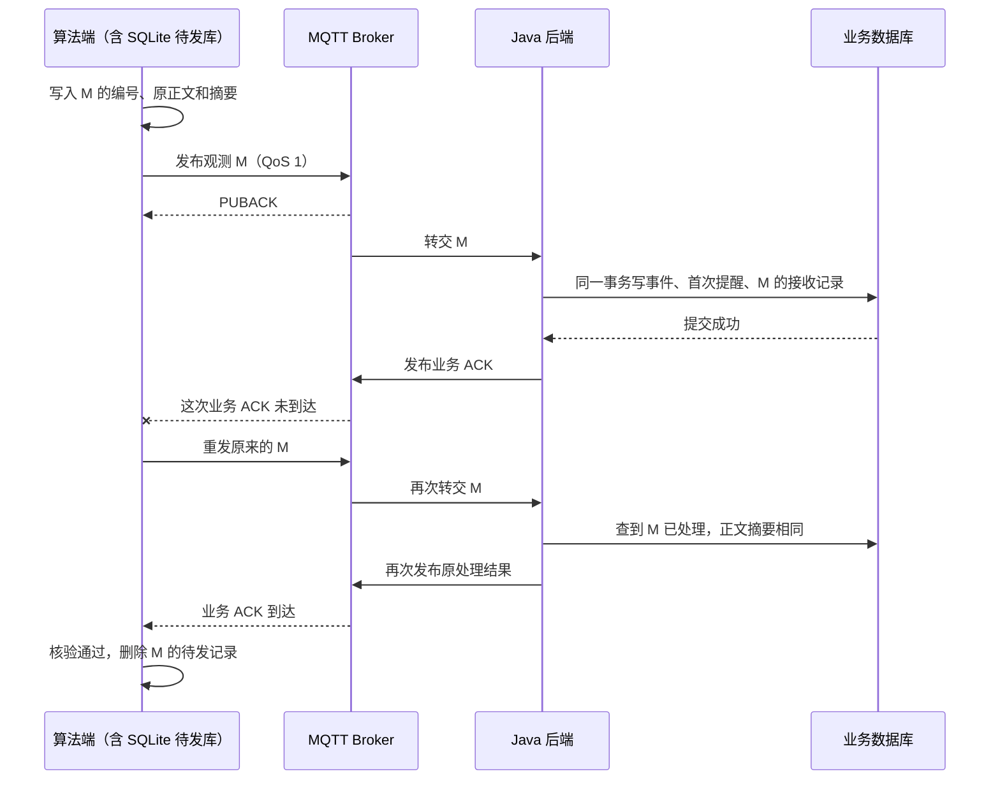

# 第五课 · 后端已经写入告警，算法却没收到确认，接下来怎么办？

接上第四课。假设牛已经有了确认轨迹，上一条观测只积累了 1 秒停留。这条新观测刚好让停留满 2 秒，按规则应该创建一个风险事件和一条首次提醒。算法发出消息，随后一直没有收到后端的答复。现在你负责算法端：删掉本地记录，可能漏掉一次风险；重发，又可能让值守人员看到两次首次提醒。你依据什么作决定？

第一遍约 20 分钟，沿第 1～4 节跟着这一条消息走，尤其留意数据库提交的那一刻。第二遍约 20 分钟，用第 5～7 节推演故障，做一次可以自己改输入的实验。能解释“后端已经成功、算法端仍显示待发”这一幕，就掌握了本课的主线。

## 1. 先认识三方，再分清两种确认

**发布者**是发消息的程序，这里是 Python 算法服务。**订阅者**是事先声明要收某类消息的程序，这里是 Java 后端。中间有一个 **Broker**，项目使用 EMQX。发布者把消息发往一个有名字的地址，叫**主题**（topic）。Broker 根据订阅关系把它转给后端。Java 此时即使还没运行到写数据库那一行，Broker 也可能已经收到了消息。

| 发生的事 | 算法端此时有了什么证据 | 本地待发记录该怎么办 |
| --- | --- | --- |
| Python 的 `publish()` 返回成功码 | 发布请求已被 MQTT 客户端接受 | 保留 |
| 收到 QoS 1 的 `PUBACK` | 这一跳的接收方 Broker 已接手消息。它可以在后续转发完成前答复 | 保留 |
| 收到后端发回的应用确认（下文简称业务 ACK），编号、正文摘要、节点和状态都对得上 | 后端已经持久记录了对这条消息的处理结果 | 成功处理的移出待发；已拒绝的先留诊断再移出 |

**QoS** 是 MQTT 对一次消息传递约定的交付级别。项目对关键消息使用 QoS 1，即协议层允许重传，接收方可能看到重复消息。**业务 ACK** 则是本项目自己定义的一条普通 MQTT 消息，由后端在数据库事务结束后发布。它也可能丢，也可能被重复收到。[MQTT 3.1.1 规范 §4.3.2](https://docs.oasis-open.org/mqtt/mqtt/v3.1.1/os/mqtt-v3.1.1-os.html) · [后端收发入口 MqttBridge](../web-springboot/src/main/java/com/example/detection/MqttBridge.java)

把下图当作**一次可能发生的时序**。M 是这条观测消息的简称。注意第一次和第二次调用后端时，数据库做了不同的事。



## 2. 算法端为什么要在发网络请求前写一次 SQLite？

先区分三种编号。`trackId` 表示这次摄像头检测会话中的一条轨迹。`sequence` 是这条来源轨迹第几次上报。`eventId` 标识其中**一条逻辑消息**。例如同一轨迹的第 7 次和第 8 次观测各有自己的消息 ID，第 7 次观测因为没收到确认发送了三遍，三遍共用原来的 ID 和正文。第四课里的 `alarm_id` 则由后端决定，多次观测可以更新同一个风险事件。

**步骤一，生成观测。** 找到 `TrackEvents._send`。它递增序号，为这条新快照分配 UUID，序列化成 JSON 文本，再把文本交给 `self.sink(...)`。这里容易读错：在正式任务入口，注入的函数是 `outbox.enqueue`。执行到这一行，算法首先做的是本地写入。可选截图在成功交接之后另行处理。[快照生成](../RailwayDetector/track_events.py) · [任务入口的 publish 参数](../RailwayDetector/ui.py)

**步骤二，把“尚未获得业务确认的消息”保存在本地。** 这张待发表叫 `pending`，放在 SQLite 数据库中。下面两句摘自 `EventOutbox.enqueue`，中间省略容量和冲突检查。[EventOutbox.enqueue](../RailwayDetector/event_outbox.py)

```python
digest = hashlib.sha256(body.encode('utf-8')).hexdigest()
# 在本地事务内写入
self.db.execute('INSERT INTO pending(event_id,body,hash,bytes) VALUES(?,?,?,?)',
                (event['eventId'], body, digest, size))
```

第一行计算**摘要**：相同的原始正文会得到相同的 SHA-256 值。第二行同时保存消息 ID、原正文、摘要和大小。重发时即使有些字段值没变，重新生成 JSON 也可能因空格或字段顺序不同而得到另一份正文。因此发送线程直接使用存下来的文本。摘要用来核对“确认的是哪一份内容”，服务身份由 MQTT 认证、主题权限和传输配置保障。

**步骤三，理解写入成功的含义。** `with self.lock, self.db:` 将检查与插入放在锁和 SQLite 事务中。正常退出该代码块时提交，异常时回滚。项目启用 WAL（预写日志）和 `synchronous=FULL`。算法进程在提交后突然退出，使用同一完好数据库重启时仍可找到待发项。若进程恰好在提交之前退出，这条新观测仍可能消失。面试时从“已成功写入本地待发库”开始描述恢复保证，这个起点很重要。

## 3. 发送线程怎样决定什么时候再发？

打开 `DetectorService._send`，依次找到下面四处。对照 `due`、`attempted` 两个函数来读。[发送循环](../RailwayDetector/mqtt_service.py) · [待发查询与重试时间](../RailwayDetector/event_outbox.py)

| 代码中的动作 | 这一步改变了什么 |
| --- | --- |
| `if not self.connected.is_set(): continue` | 断网时暂停发送，已经写入的记录还在 SQLite 里。 |
| `for row in self.outbox.due(16)` | 一次最多取 16 条到了重试时间的记录。取出来并不会从表里删除。 |
| `publish(self.prefix+'/events', row['body'], qos=1)` | 发布原正文，短暂等待协议层发布完成。这里的等待有约 2 秒的期限，以便线程继续处理待发项。 |
| `finally: self.outbox.attempted(row['event_id'])` | 无论这次发布返回还是发生发送异常，只要该行仍在待发库，就更新尝试次数和下次重试时间。 |

假设第一次尝试前 `attempts=0`，代码算出的下次间隔是 1 秒；再试后是 2、4、8、16 秒，随后封顶在 30 秒。这个做法叫**退避**。它让短暂故障恢复后能较快补发，也能在长时间故障时降低重试频率。实际发出的时刻还受连接状态与排队影响。如果业务确认恰好已经删掉了该行，`attempted` 查不到记录，就结束本次调用。

**停下来预测。** Broker 已回 PUBACK，但 Java 此时才刚把消息放进内存队列，随后 Java 进程退出。算法下次重连后还能拿什么补发？答案是 SQLite 中待发的原正文和原 ID。假如在 PUBACK 到达时就删掉它，恰好会在这个窗口失去算法侧的恢复依据。

## 4. Java 怎样做到“可以重发，首次提醒只创建一次”？

**事务**的意思是几项数据库修改一起提交，出错则一起回滚。**幂等**在这里有一个可以数出来的结果：同一份 M 处理两次，第一次产生的业务事件和首次提醒，第二次都不再新建。进入 Java 的 MQTT 回调后，工作线程的调用顺序决定了这项性质能否成立。[MqttBridge.consume](../web-springboot/src/main/java/com/example/detection/MqttBridge.java)

```java
var ack=ingest.receive(parts[2],payload);
// receive 返回时，数据库事务已经提交
publish("railway/v3/"+parts[2]+"/ack",mapper.writeValueAsBytes(ack));
```

**第一步，先验证。** `receive` 对收到的原正文计算摘要，解析消息并验证字段。例如类别 ID 和名称要对应、框在图像边界内。进入接收事务后，对消息所属的会话行执行 `SELECT ... FOR UPDATE`，核对节点、摄像头、会话和代次。行锁让同一会话里的两个并发消费者按先后次序更新，避免两边同时看到“从未接收”就各创建一条。[DetectionIngestService.receive](../web-springboot/src/main/java/com/example/detection/DetectionIngestService.java)

**第二步，查数据库是否见过这条消息。** 接收表 `detection_receipt` 的主键是 `(worker_id, event_id)`。如果节点和消息 ID 已存在，比较正文摘要。相同就返回持久记录里的处理结果，跳过业务聚合。不同表示同一个 ID 被用于两份内容，后端记录冲突并返回拒绝。这解释了发送端为什么保存原正文。[接收表主键](../web-springboot/src/main/resources/db/p0-migration.sql)

**第三步，判断一条全新消息能否推进轨迹。** 按节点、摄像头、会话和轨迹定位来源，再比较序号。例如第 8 条已经处理，第 7 条第一次延迟到达，后端会给这条旧消息留接收记录，注明 `stale snapshot ignored`，返回 `APPLIED`，同时维持轨迹当前状态。若两个不同的新消息竟声称占用当前相同序号，则拒绝。**消息 ID 回答“这份消息处理过吗”，序号回答“它还能推进这条轨迹吗”。**

**第四步，一起提交。** 对能推进状态的 M，先调用 `incidents.apply(...)` 执行第四课的风险规则，按需要写风险事件、提醒，以及已配置渠道的待发送任务，然后写入 M 的接收记录。上述数据库操作位于同一接收事务里。假如写接收记录时报错，前面刚创建的事件也会回滚，应用不会提前发出成功确认。若提交成功，即使下一行发布 ACK 时崩溃，重发 M 也能在第二步命中原记录。[业务聚合与提醒](../web-springboot/src/main/java/com/example/detection/RiskIncidentService.java)

**第五步，由算法核验 ACK。** 后端在 `/ack` 主题发回 `workerId`、`eventId`、`payloadHash`、`status` 和原因。算法按节点、消息 ID、原文摘要和认可的状态匹配。合格的 `APPLIED` 移出待发表。合格的 `REJECTED` 代表后端已持久隔离了有问题的消息，算法保留有界本地诊断，并移出待发，避免永久重送错误内容。错误节点、错误摘要或陌生状态的 ACK 无法删掉 M。若已经删过，再收到一份相同 ACK，查不到待发项即可结束。[EventOutbox.acknowledge](../RailwayDetector/event_outbox.py)

## 5. 用一张表推演“在这里断掉会怎样”

纸上设 M 是触发首次风险的那条合法观测。这张表**只数 M 带来的新增行**，忽略之前已有的轨迹观测。第一遍把最后一列盖住，自己预测。

| 中断位置 | 算法本地是否有 M 待发 | 后端是否已经提交 M | 恢复后怎样处理 |
| --- | --- | --- | --- |
| 本地尚未提交就崩溃 | 未获持久保证 | 无 | 这次快照可能丢失。后续快照能带来更新的状态，无法完整还原丢失的时空细节。 |
| 本地已提交，尚未发送就重启 | 有 | 无 | 重新打开同一数据库，发送保存的原文。 |
| Broker 已确认，后端队列满或数据库不可用 | 有 | 无 | 后端不回成功业务 ACK，待发项留存，之后退避重发。 |
| 已开始创建告警，但写接收记录失败 | 有 | 无，事务回滚 | 重试可以完整执行一次。 |
| 后端已提交，业务 ACK 丢失 | 有 | 有 1 条接收记录，事件和首次提醒各新增 1 条 | 再收 M 时返回已存结果，两项业务计数保持不变。 |
| 算法收到业务 ACK，删除待发行之前崩溃 | 有，若删除事务尚未提交 | 有 | 重启可能再发一次，由相同机制处理。 |
| 正常完成 | 无 | 有 | 业务端仍有接收记录，算法可以释放这条待发占用的空间。 |

不同问题各有对应的键。M 原样重发，用接收表的消息主键挡住重复副作用。M 和下一条观测 N 各有自己的 ID，都应被接收；若它们恰好落在同一风险的同一提醒区间，则由第四课的 `(alarm_id, kind, bucket)` 阻止重复提醒。前一个键不能代替后一个键。

## 6. 两个小实验，把“我觉得”变成“我看到了”

**实验 A，亲手观察何时能删待发。** 在项目根目录运行下面的命令。它用临时 SQLite 数据库和项目真实的 `EventOutbox`；M 与 ACK 为手工构造的教学数据，只用来观察算法端。每个 `print` 之前先预测表里还有几条。

```bash
PYTHONDONTWRITEBYTECODE=1 PYTHONPATH=RailwayDetector python3 - <<'PY'
import hashlib
import json
import tempfile
from pathlib import Path
from event_outbox import EventOutbox

worker, event_id = "lesson-worker", "a" * 32
body = json.dumps({"workerId": worker, "eventId": event_id, "sequence": 7})
ack = dict(workerId=worker, eventId=event_id, status="APPLIED",
           payloadHash=hashlib.sha256(body.encode()).hexdigest())

with tempfile.TemporaryDirectory() as folder:
    path = str(Path(folder) / "lesson.db")
    outbox = EventOutbox(path, worker)
    outbox.enqueue(body)
    outbox.attempted(event_id)  # 模拟做过一次发送尝试，尚无业务确认
    print("已尝试发送", outbox.count())
    outbox.close()

    outbox = EventOutbox(path, worker)
    try:
        print("重新打开", outbox.count())
        print("错误摘要", outbox.acknowledge(dict(ack, payloadHash="wrong")), outbox.count())
        print("匹配的确认", outbox.acknowledge(ack), outbox.count())
        print("重复的确认", outbox.acknowledge(ack), outbox.count())
    finally:
        outbox.close()
PY
```

预期依次是 `1`、`1`、`False 1`、`True 0`、`False 0`。最后一个 False 表示已经没有对应待发项。再读现有用例 `test_process_exit_after_commit_replays_on_reopen`，它让写完记录的子进程直接退出，重新打开后检查保存的正文。另一个 `test_sqlite_disk_full_rolls_back_new_event_and_preserves_previous` 则真的让 SQLite 写满，断言新写入失败且旧待发仍在。[待发库测试](../RailwayDetector/tests/test_outbox.py)

**实验 B，在后端丢掉第一份业务确认。** 找到下面的测试方法。第一句 `receive(e)` 的返回值被有意丢弃，数据库此刻已提交；下一句再用同一消息调用接收服务。运行后检查三件事：回复是 `APPLIED`、业务表只有 1 条事件、接收表只有 1 条记录。该用例直接驱动后端服务，使用兼容协议的测试快照，聚焦于重放路径。[lostApplicationAckReplaysCommittedDataWithoutDuplicateAlarm](../web-springboot/src/test/java/com/example/P0IntegrationTest.java)

```bash
lesson_jdk="$PWD/workspace/runtime/jdk17/usr/lib/jvm/java-17-openjdk-amd64"
env -i PATH="$lesson_jdk/bin:/usr/bin:/bin" JAVA_HOME="$lesson_jdk" LANG=C.UTF-8 \
  /data/zxy/RailwayProject/workspace/apache-maven-3.9.9/bin/mvn -B -o \
  -f web-springboot/pom.xml -s "$PWD/deploy/maven-settings.xml" -gs "$PWD/deploy/maven-settings.xml" \
  -Dmaven.repo.local="$PWD/workspace/runtime/m2" \
  '-Dtest=P0IntegrationTest#lostApplicationAckReplaysCommittedDataWithoutDuplicateAlarm' test
```

这条命令用 H2 内存数据库，可以单步设断点。若面试官追问真实链路，仓库另有隔离环境历史实测：使用 TLS MQTT，故意忽略已提交的业务 ACK，让算法积累重试，恢复后待发归零；Broker 重启和强制终止后恢复，同一场景回放后仍为 1 条事件。随后另测算法进程重启，创建新会话，最终总数变为 2。两个计数对应不同操作。[真实 MQTT 故障用例](../web-springboot/src/test/java/com/example/P0MqttIntegrationTest.java) · [该次故障记录](test-results/p0-reaudit-2026-11-10/mqtt-faults.json)

## 7. 面试官继续追问时，答案到哪里为止？

| 追问 | 结合本项目怎样回答 |
| --- | --- |
| 换成 QoS 2，能省掉应用确认吗？ | QoS 2 增加协议交互，用于一次 MQTT 交付中的重复控制。Java 仍可能在 MQTT 回调之后、数据库提交之前崩溃。只要业务要求确认已持久处理，就仍需要相应的业务凭据。[MQTT 规范 §4.3.3](https://docs.oasis-open.org/mqtt/mqtt/v3.1.1/os/mqtt-v3.1.1-os.html) |
| 已经配置固定客户端 ID、持久会话和自动重连，为什么还用 SQLite？ | 这些设置帮助恢复连接和订阅。Python Paho 客户端对象重建时，部分在途会话状态只存在旧进程内存里；即使 MQTT 已确认，应用处理也可能尚未完成。SQLite 保存业务仍需跟进的原文。[Paho 已知限制](https://eclipse.dev/paho/files/paho.mqtt.python/html/index.html#known-limitations) |
| 能保证任何情况下消息都不丢吗？ | 保证从本地成功写入开始，以存储完好、容量受控、服务最终恢复为前提。单条事件上限 16 KiB，待发默认有 10,000 条和 64 MiB 正文预算两道上限。写满会显式报错，使对应监测任务失败，保住已有待发项。未提交、磁盘损坏、长时间停监期间的观测都不能承诺恢复。 |
| 后端处理跟不上，开更多线程就行吗？ | 当前接收池 2 个线程、队列 64。满时不给业务 ACK，压力会表现为算法侧积压。增加线程还受同一会话行锁与数据库吞吐限制。排查时按节点查看 `pendingEvents` 是否持续增长，再看重试、订阅状态、后端队列饱和和数据库提交错误。 |
| 哪些消息会补发？ | `railway/v3/{worker}/events` 上的关键观测走持久待发，后端通过 `/ack` 发回处理结果。状态进度走 `/status`，可由后续新报告刷新。启停走 `/control`，后端根据保存的启用意图周期下发带有效期的控制，算法用代次挡住迟到的旧指令。主题中的 v3 与当前观测正文的 V4 分别描述不同接口。[算法服务的四类主题](../RailwayDetector/mqtt_service.py) |
| 算法服务重启，补发旧消息和开始新检测会冲突吗？ | 已持久化的待发使用原 ID、原会话和原文继续补发，后端依原会话状态与时间校验处理。新的检测任务需要新的会话来隔离重新从 1 分配的轨迹编号。 |
| 收到 APPLIED 能证明短信已到、人已读吗？ | 这个状态说明后端已记录处理结果，甚至可能是“旧快照已忽略”。确定风险、站内已读和外部渠道送达都各有判据。外部通知任务可以随事务写入，外部服务实际发送另行处理。 |

**一分钟口述练习**

> 我负责算法到后端的观测消息传递。每条关键观测先生成固定 ID，把原正文写入本地 SQLite，再用 MQTT QoS 1 发给后端。后端在同一事务中处理风险并保存接收记录，提交后才回复业务确认。举个例子，风险已经写入、确认却丢了，算法会重发原消息。后端按节点、消息 ID 和正文摘要查到已有结果，就重新确认，值守人员不会因为同一消息重发看到第二次首次提醒。这个恢复能力从本地写入成功开始，也受磁盘和待发容量限制。

**合上讲义，自测三题。**

1. Broker 已回 PUBACK，Java 正准备写库就退出。此时算法端保留了什么？恢复后由谁重发？如果此前只使用内存队列，什么情况下会失去恢复依据？
2. Java 已提交但 ACK 丢了。算法若在重试时重新生成 `eventId`，保留原序号且此时后端仍停在该序号，会走哪条分支？保留 ID 却重新序列化成不同正文又会怎样？
3. 假设数据库故障期间每秒产生 20 条消息，待发库原来为空、没有任何确认，且先只考虑 10,000 条上限。最多能容纳多长时间的新增消息？如果平均每条正文达 8 KiB，哪道预算先到？届时该怎样向面试官界定“可恢复”？

<details>
<summary>完成后展开答案</summary>

1. SQLite 中保留原 ID、原文和摘要。算法发送线程按重试时间再次发布，后端恢复后可提交并确认。若只放内存，此时算法进程也重启，便可能再也找不到未获业务确认的那条原消息。
2. 换消息 ID 会跳过原接收记录，用另一个消息冒用当前已处理序号，按序号冲突拒绝。沿用原 ID 但正文摘要不同，会更早在接收记录检查处按内容冲突拒绝。正确重试复用原 ID 和原正文。
3. 仅算条数为 10,000 ÷ 20 = 500 秒，即 8 分 20 秒。64 MiB ÷ 8 KiB = 8,192 条，在这种平均大小下约 409.6 秒就先碰到正文预算。两个数都是教学估算。项目能在容量内保存已提交的待发并在恢复后重试，持续停机超过预算会使新的写入显式失败，无法补回停监期间的全部观测。

</details>

[上一课 · 风险判定与提醒](interview-lesson-04.md) · [下一课 · 花屏排障与结果存储](interview-lesson-06.md) · [八轮学习路线](interview-learning-path.md)
