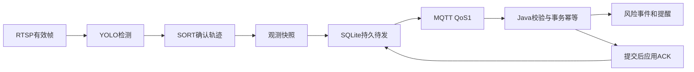

# 铁路监测项目：AI 应用开发面试速查卡

配合[完整讲解手册](interview-guide-ai-application.md)使用。以当前代码和已有测试为依据，不代表已经完成客户现场验收。

## 1. 个人定位

> 我负责视觉模型接入、目标跟踪和告警消息链路，重点解决模型结果怎样变成可追溯、可恢复的业务事件，并参与后端协议和风险聚合联调。

你的亮点：**模型工程化 + 可靠消息 + 业务状态 + 故障验证**。

## 2. 一张脑图

另外两条独立路径：后端持久启用意图 → 算法任务；原始录像/检测采样 → 证据复核。浏览器关闭不再决定后台告警是否入库。

## 3. 现场最容易答错的八件事

| 问题 | 正确要点 |
| --- | --- |
| YOLO 检到就告警？ | 检测、跟踪、风险规则、提醒、人工处置分开 |
| SORT 能保证遮挡时 ID 不变？ | 当前纯几何/运动关联，无类别硬门槛和外观 ReID，不能保证 |
| 鸟这个类别有吗？ | 有鸟巢，当前没有独立飞鸟类别；还需考虑域外误判与采样漏检 |
| 一分钟发几次？ | 新建同一持续 RISK、间隔60秒且无升级重入：[0,60) FIRST一次，60秒后有效观测再有ONGOING |
| PUBACK 后删待发？ | 等 MySQL 处理提交后的应用 ACK，校验 ID 与正文摘要后删 |
| QoS2 就业务只执行一次？ | 协议交付不能代替数据库事务与业务幂等 |
| 30FPS 源就是30FPS检测？ | 源帧率、推理 FPS、显示上限、采样回放分别统计 |
| 30天/2TB一定存一个月？ | 要按总码率核算；当前4K样例连续原码流约需4.27TB/月 |

## 4. 算法参数与解释

- 当前默认权重 best1030.pt：13 类，检查记录约 775 万参数；四尺度 stride 4/8/16/32，含 C3TR。
- 仓库有 MobileViT 源码，不能据此说当前权重已使用 MobileViT。
- 推理：letterbox → BGR/RGB与维度变换 → 归一化 → 前向 → NMS → 坐标还原。
- 当前默认检测分数门槛0.25，NMS IoU0.3；风险分数阈值另配。
- 当前 SORT：Kalman预测 + IoU矩阵 + 匈牙利分配；min_hits=5，运行路径采用默认3秒时间窗口。
- NMS、跟踪匹配、业务重关联的 IoU 阈值碰巧都可为0.3，作用不同。
- 空帧推进缺失状态；坏帧中断观测，不能拿空目标代替输入失败。
- firstSeen 是确认观测起点，不是物理入画时刻；低推理FPS会延长确认时间。

## 5. 消息身份与确认

- workerId：哪个节点。
- cameraId：哪个摄像头。
- sessionId：哪次检测会话，防止重启后 trackId 重用。
- generation：控制代次；旧控制不能启动旧任务。
- trackId：局部轨迹。
- sequence：本来源轨迹快照版本。
- eventId：一条逻辑消息，重试保持 ID 和原正文。
- alarm_id：业务事件；notice_id：一次具体提醒。

主题：`railway/v3/{worker}/control、status、events、ack`。当前观测消息体为 V4，表达 MISSING/observedThrough/missingSince；不要混淆主题版本、消息版本与 MQTT 协议版本。

可靠交付口述：

> 先 SQLite 持久化，再 QoS1 发送。Java 验证来源和序号，以唯一接收键和事务控制业务副作用，提交后回应用ACK。数据库已提交但ACK丢失时重发，返回原结果，不重复创建事件与提醒。

三个崩溃窗口：

1. 写盘后没发：本地恢复重发。
2. 收到Broker确认没入库：本地继续保留待发。
3. 已入库没拿到应用ACK：幂等重发。

边界：尚未写盘的当前结果、磁盘损坏、长期容量耗尽不能无条件保证。关键 outbox 默认10000条/64MiB，满时停止对应监测并报告。

## 6. 状态与聚合

- 算法：ACTIVE / MISSING / ENDED / INTERRUPTED。
- 风险：PRESENT / MISSING / CLEARED / INTERRUPTED。
- 人工：未处理 / 处理中 / 已处理。
- 已读：每账户、每具体提醒的回执。

风险规则：启用 + 类别 + 当前分数 + **框底边中心点进入归一化矩形ROI** + 停留证据。

未配规则：待核验 OBSERVATION；可有站内 FIRST 观察提示，不冒充确定风险和外部风险通知。

业务重关联：同摄像头、同会话、同类、短时间、空间重叠且唯一候选；多候选保守新建。没有跨会话物理身份保证。

持续提醒：FIRST / ONGOING / ESCALATION，唯一键 `(alarm_id,kind,bucket)`。需要新鲜有效观测，断流不会仅凭计时器持续提醒；已读和人工已处理不等于风险消失。

## 7. 结果到底存什么

- 原始帧：内存最新帧替换；并非逐帧写SQL。
- 关键观测：SQLite待发，后端MySQL接收记录和风险状态。
- 媒体：独立原始录像、关键截图、带对应元数据的检测采样回放。
- 原录像时段当前是录制端估计；精确叠框用于同次推理采样。
- 媒体30天预算不代表所有SQL历史表已有30天归档策略。
- 截图/采样失败可报告，不能撤销已交接的关键观测。

## 8. 并发与性能，只报有条件的数字

已实现：一路一任务、每帧一次检测、共享模型公平访问、最新帧、有界队列、媒体分流、多人共享结果。

已有实测：

- 三路854×480/30FPS源，完整链路CPU推理并发窗口约各1FPS。
- 三路当前3840×2160源，只读解码+共享CPU模型探针约30秒，各27帧，约0.88FPS/路。
- 后者解码错误0，抽查12帧像素一致；最大解码后至推理完成帧龄约1.774秒。

后者不含完整业务落库负载，不是九路上限，更不是现场快速目标识别率。配置最大9任务不等于已验收9路30FPS。

延迟拆解：摄像机/网络 → 解码 → 模型排队 → 推理 → 确认/停留 → 写盘/传输/事务 → 展示。

## 9. 后端只抓这几个点

- 接收表唯一键 + 同事务的聚合/提醒 + 提交后ACK。
- 每会话锁与来源序号，防止并发和乱序回退。
- 持久enabled意图 + 控制代次 + 租约 + 新会话隔离。
- 人工字段与机器字段分开；version冲突409；提醒已读独立。
- liveness、readiness和单路有效推理进度不同。
- 外部短信/Webhook有代码路径，缺真实配置，尚未真实接通。

## 10. 三个故事与证据

1. 持续目标告警迟迟不发：发送条件与录像缓存耦合 → 先持久交接、媒体独立 → 持续帧和异常注入验证。
2. 数据库成功但ACK丢：eventId/摘要/事务幂等 → 重发返回原结果 → 数据库断连和后端硬杀恢复。
3. 非空花屏仍被推理：源与转发对照 → 队列512改8192 + 严格解码门槛 → 已知坏流拒绝与当前4K抽查。

每个故事按“现象、证据、原因、取舍、验证、边界”讲。看[验证摘要](test-results/frame-quality-2026-11-11/verification-summary.json)，能解释测试内容比背105或102这个数量更重要。

## 11. 如果面试偏 RAG / Agent

> 我的主要经历是视觉AI应用的工程落地。可迁移的能力包括模型接入、结构化结果校验、异步任务、工具类副作用的幂等思路、状态治理、可观测性和评测。RAG/Agent具体能力需要另外用对应实现证明。

不把当前项目包装成已经有向量库、RAG、Agent或大模型训练。先把已有链路讲透，再补JD需要的检索、生成、工具调用和评测实践。

## 12. 最后五分钟自问

- 我能在白纸上画出模型到业务ACK吗？
- 我能讲清楚“同一目标一分钟”在数什么吗？
- 我会不会把缺失、断流、人工处理混为同一状态？
- 我能准确承认当前SORT与CPU吞吐的局限吗？
- 我说的每个数字、优化和训练结论能找到证据吗？
