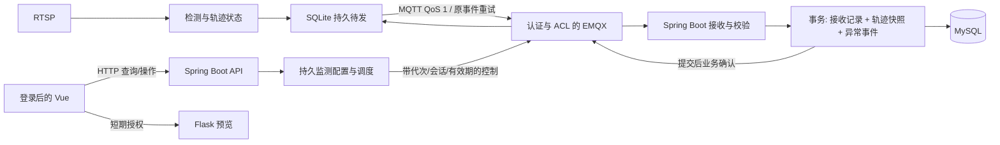

# P0 修复方案与实施记录

范围：交付审查 R01–R06。用户已明确要求方案后继续分批实现及验证。当前工作区已有修改保留；测试使用临时文件、隔离数据库和隔离 Broker，不直接迁移或重启现有部署。

## 目标架构

关键事件首先持久化，收到后端事务提交确认才清理。Broker 的协议确认与数据库业务确认分开。浏览器不消费原始告警、不创建自动告警、不持有检测任务租约，也不持有 MQTT 服务凭据。

一期采用单个业务后端与单个检测工作节点；数据库持久配置指定工作节点，不能启动多个相同 workerId 的实例。多节点高可用、遮挡算法优化、真实短信和完整媒体平台仍属于后续范围，不能随本轮宣称完成。

## 数据与协议约定

- `eventId`：不可变消息的 UUID，重试使用同一 ID 和同一内容。
- 轨迹键：`workerId + cameraId + sessionId + trackId`，不声称代表跨遮挡/跨会话物理实体。
- 每条轨迹快照带单调 `sequence`、首末观测时间、状态、该类别的置信度及类别证据；乱序低版本不能覆盖高版本。
- 新轨迹确认后立即生成首条；持续更新限频，结束/中断单独生成。告警时序独立于录像。
- 传输事件不带 Base64 帧；媒体状态与事件分开。
- UTC 带时区时间进入协议，服务端显式转换/保存；页面展示上海时间。事件时间不使用浏览器当前时间。
- 接收表 `(worker_id,event_id)` 唯一，附内容哈希；同 ID 不同内容隔离，不能当作普通重复确认。
- 自动异常事件业务键唯一；后续观测只更新自动检测字段，不覆盖人工处置状态/处理人/处理结果。
- 无法验证的数据进入可追踪拒绝记录，确认类型区分 APPLIED / REJECTED；拒绝不算成功告警。

## 分批实施

| 批次 | 对应 P0 | 核心改动 | 完成门槛 |
| --- | --- | --- | --- |
| A 检测侧 | R01、R05 基础 | SQLite outbox；首次/更新/结束事件；有界待发、确认重试；录像与告警解耦 | 连续目标 EOF 前送出；断网/进程重建后重试；无界内存队列消失 |
| B 接收与聚合 | R03、R04、R05 | Java MQTT 消费；事务幂等；严格校验；轨迹状态与自动异常更新；增量迁移 SQL | 重复/乱序/错误类别分数/提交失败/确认丢失测试通过 |
| C 后台监测与页面 | R02 | 持久 desired state；后台调度与带有效期控制；页面独立启停检测；移除页面落库 | 无页面仍运行和入库；后台重启恢复配置；旧控制不复活已停止任务 |
| D 身份与部署 | R06 | Spring Security Session/CSRF/角色；口令升级；用户 DTO；预览授权；MQTT 认证 ACL/TLS/端口隔离 | 未登录/越权/伪造确认/无授权拉流均拒绝；真实业务仍可用 |
| E 综合验证 | R01–R06 | 跨模块回归、隔离 MQTT/数据库、故障注入、迁移与回退说明 | 每项有结果与未覆盖边界，不以构建成功代替业务验收 |

## 实现决策

### A：检测侧持久发送

使用 Python 标准库 SQLite，WAL + synchronous=FULL；事务提交是“已持久接收”的起点。生产使用本地可持久磁盘，包含 WAL 的一致性备份，不使用临时目录或网络共享文件系统。内存只保留活跃轨迹和有限发送窗口。

待发记录有数量/字节预算，达到上限明确进入阻塞/失败状态并保留已有记录，不静默删除关键事件。不承诺无限断网缓存。发布采用 QoS 1，协议发送完成后仍保留记录，直到收到可信后端 APPLIED 或持久 REJECTED。超时退避重投同一消息；ACK 只能确认对应 worker/event/hash。

首条和最终事件不合并；普通更新在生成层限频，累计证据随快照发送。写盘/编码失败不撤销此前已持久事件；进程异常由后台识别为中断，不能伪装目标正常消失。

### B：事务接收与确定性聚合

使用现有 Spring Boot/MySQL，并引入 Paho Java 客户端。接收端有界处理，事务内写接收记录与业务事件，成功提交后发送应用 ACK；数据库不可用时不发成功 ACK。ACK 丢失导致的重复投递由数据库唯一键消除。

每个轨迹保存独立 firstSeen/lastSeen，按 sequence 合并自包含快照。类别和对应置信度绑定，类别变化可更新；不再把不同类别的最高分混在一起。自动告警首次及时创建，后续更新，不等待摄像头静默。状态区分 ACTIVE / ENDED / INTERRUPTED，人工处理字段独立保留。

P0 首版对输出作“待核验观察事件”处理，不根据识别置信度推断事故严重程度；完整 ROI/风险规则属于 R08 后续工作。类别证据策略是确定性处理，不宣称修复了模型误检。

迁移仅新增表、列与索引，历史事件保持；不能从历史描述文本猜造可靠 eventId。迁移脚本在临时数据库验证，现有业务库的执行作为部署切换步骤。

### C：后台管理检测期望状态

新增监测配置/状态 API，管理员显式启用监测；查看摄像头与启停检测分别操作。默认不擅自开启全部摄像头。

后端持久保存 cameraId、workerId、enabled、控制代次、sessionId、实际状态和错误。调度周期性发送有有效期的期望控制、接收状态；同代次同会话幂等，旧代次/过期命令拒绝。禁用状态写库后，后端继续纠正可能迟到的旧启动。

同一个服务器会话只允许实际启动一次。工作进程重启或任务终止导致本地跟踪编号重置时，必须请求新代次/新会话，旧会话中断；不能借相同 trackId 猜测物理目标连续性。设备采用软删除以保留迟到事件的来源，已启用监测的视频源不能原地修改。

后台控制暂时不可用时，工作节点在控制租约到期后停止并记录中断；这与页面退出无关。持续控制面故障不承诺仍可无限监测，必须暴露监测中断。

### D：覆盖所有入口的访问控制

- 保留同源 Session 模式，引入 Spring Security，登录成功保存 SecurityContext 并更换会话 ID；保留 CSRF 防护，页面通过 CSRF 接口取令牌。
- 管理接口只允许管理员，普通值班员可查询/处置告警；处理人取认证身份。停用/口令修改使旧授权失效。
- 用户响应 DTO 不含 password；新增口令使用 BCrypt，旧 MD5 仅作为明确迁移路径登录后升级；禁止固定口令重置及生产默认账号直接开放。
- 预览通过后端发放短期授权，Flask 校验授权并从可信后端解析 cameraId 的源地址，拒绝客户端任意 RTSP URL。预览连接相互隔离。
- 浏览器移除直接 MQTT；工作节点与后端使用独立凭据，Topic ACL 限制事件、控制、状态、ACK 的方向与 workerId。生产跨主机启用 TLS；本地明文仅允许环回隔离模式。
- 密钥通过受控环境变量/挂载文件提供，不入库到前端、不写入源码或日志。安全配置缺失时明确失败，不退回匿名。

## 验收矩阵

1. 连续 300 帧正目标：首条确认事件在 EOF 前进入发送链路，后续有界；正常短链路首条持久落库目标 <= 1 秒（不包含模型达到确认门槛之前的时间）。
2. 新事件落 SQLite 后进程终止：重启重投；Broker/后端不可用：保留并退避；空间不足：明确故障且不删未确认事件。
3. 数据库提交前失败：无成功 ACK；提交后 ACK 丢失：重投仅一条业务事件；同 eventId 不同 payload：隔离。
4. 同轨迹类别变化、低/高 sequence 倒序、重复消息、null/NaN/越界分数、无时区时间、错误 camera/worker/session：有确定结果。
5. 两页面、零页面、页面刷新、缩小布局、关闭预览：不改变后台 enabled，不重复创建自动告警。
6. 后端/工作节点重启、迟到启动/停止、控制租约过期：配置可恢复，状态不倒退，旧命令不能复活已禁用监测。
7. 未登录 HTTP=401，越权/CSRF失败=403；不能读取密码哈希、冒用处理人、任意重置口令或绕过授权拉流；停用后旧会话失效。
8. Broker 匿名登录、跨 worker 发布、冒充 ACK/控制被拒绝；授权端到端链路通过。

可靠性承诺仅覆盖已持久事件在本地/数据库磁盘正常、配置正确且容量未耗尽时的进程/链路恢复。磁盘永久损坏、节点永久丢失、模型漏检、未达到持久提交的瞬间及无限离线不在此承诺内。

## 实施状态

- [x] 核对 P0 与当前工作区、确认本轮继续实现范围。
- [x] 建立实现方案与验收矩阵。
- [x] A 检测侧与持久发送。
- [x] B 接收与聚合。
- [x] C 后台监测与前端切换。
- [x] D 认证、预览与部署安全配置。
- [x] E 综合回归与结果记录。

本轮结果与验证边界见 [P0 实现与验证记录](p0-implementation-results.md)。上述完成状态指实现阶段的源码与隔离验证；随后用户要求运行验证，已完成 [本机验收部署](p0-local-deployment.md)。

参考实现依据：[Spring Security 会话持久化](https://docs.spring.io/spring-security/reference/servlet/authentication/session-management.html)、[Paho Java 客户端](https://eclipse.dev/paho/files/javadoc/org/eclipse/paho/client/mqttv3/MqttClient.html)、[SQLite 同步策略](https://www.sqlite.org/pragma.html)、[EMQX 认证](https://docs.emqx.com/en/emqx/latest/guides/access-control/authn/authn.html)。具体库版本沿项目兼容范围锁定，并以本地构建/集成测试验证。
